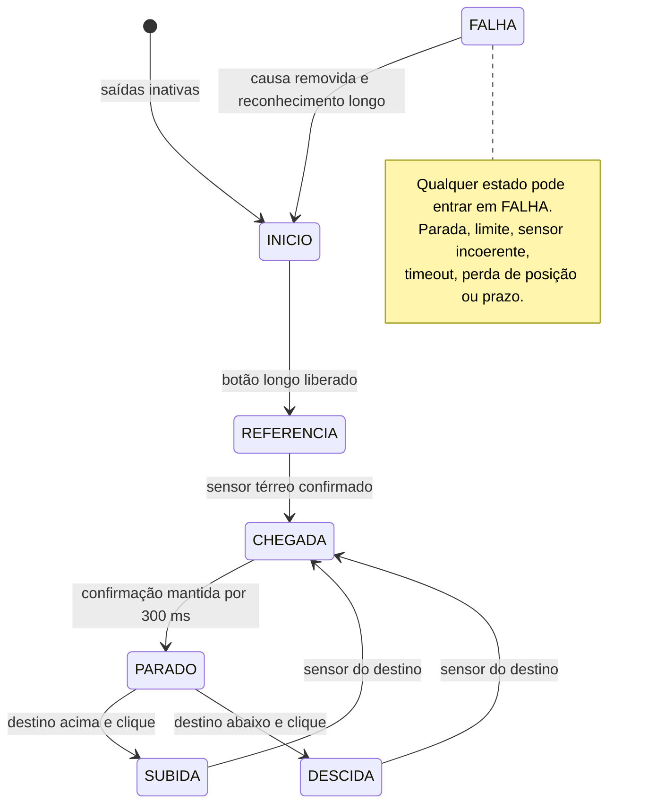

# Arquitetura e comportamento

## Camadas

`inputs.c` normaliza a interação: debounce de 30 ms, filtro IIR de primeira ordem
com fator 1/4, zona morta, histerese e um evento por excursão do joystick.
É necessário retornar fisicamente ao centro antes de nova seleção; cruzar o
centro filtrado ao inverter o joystick não rearma a seleção. Botão pressionado
durante o boot não inicia referência. Clique curto e longo só são emitidos na
liberação, uma vez por pressão. Toda entrada digital do port já deve vir
normalizada como “true = ativo”, independentemente de sua polaridade elétrica.

Sensores de andar são filtrados. Parada, fins de curso e combinação bruta de
dois sensores de andar têm prioridade e não esperam debounce para atuar.
O port deve capturar pulsos críticos menores que 10 ms ou implementar corte
independente: o polling só garante observação de pulsos que interceptem amostras.

`elevator.c` implementa FSM por tabela de ponteiros para funções, conforme a
orientação do material de técnicas de programação. Guardas globais precedem
todos os handlers. `motor.c` limita comando, aplica rampa e intertrava reversão.
`display.c` produz duas linhas ASCII de 16 caracteres, sem depender do controlador
do LCD. A adaptação de acentos, endereço e backpack I²C fica no port.

`controller.c` compõe entradas e FSM no mesmo passo. Uma transição de estado
cancela uma pressão de botão ainda em andamento: soltar um botão iniciado antes
da falha não pode reconhecê-la, nem uma pressão iniciada em viagem vira pedido
quando a cabine chega. Isso também é coberto por testes com entradas brutas.

## Contratos da FSM

- `INICIO`: nenhuma posição referenciada após reset, mesmo com sensor ativo.
- `REFERENCIA`: descer até o sensor 0; sensor 0 já confirmado permite referência
  sem deslocamento. Timeout de 15 s. Fim inferior não substitui sensor de andar.
- `PARADO`: só aceita viagens se a posição referenciada continuar confirmada.
  Pedido do próprio andar gera aviso sem movimento.
- `SUBIDA`/`DESCIDA`: um único destino. Exigir passagem pelos sensores em ordem,
  sem pular andares. Timeout de 20 s e máximo de 2 s para deixar cada sensor.
- `CHEGADA`: comando zero imediatamente, confirmar permanência por 300 ms.
  Perda do sensor nessa espera gera falha; não tentar corrigir sozinho.
- `FALHA`: comando zero, destino descartado, referência invalidada. A primeira
  causa fica registrada; reconhecer enquanto uma guarda continua ativa não funciona.

Um intervalo entre chamadas de controle superior a 50 ms gera falha. Tempos
usam subtração `uint32_t`, incluindo o transbordamento de milissegundos. O relógio
deve ser monotônico modular e chamado periodicamente; suspensão de vários dias
não faz parte do contrato. Estados internos não são uma API de comandos.

## Acionamento

Comandos usam permilagem internamente (0–1000) e percentual no LCD/USB. Valores
iniciais para simulação: referência 15%, viagem 25%, teto 30%, rampa 20 pontos
percentuais/s. Todos estão em `elevator_config.h`. Não representam torque ou
velocidade garantidos; podem ser insuficientes até para vencer atrito do motor real.

- **Parada normal:** ao confirmar destino, zerar comando imediatamente. Rampa
  de desaceleração depois do sensor aumentaria ultrapassagem sem medir distância.
- **Reversão:** reduzir comando até zero, esperar 300 ms, depois partir no sentido
  oposto. A FSM recusa mudança de destino em viagem; a interface de motor mantém
  o intertravamento adicional, testado separadamente.
- **Falha:** zerar comando imediatamente e sinalizar `MOTOR_FAULT` ao port.

Os 300 ms não são dead time de transistores nem prova de que o rotor parou.
Precisam de validação mecânica/eléctrica. O driver da ponte deve aplicar seu
próprio intertravamento elétrico. `direction=0,pwm=0` significa saída inativa no
contrato lógico; brake/coast dependem da ponte. Desligar não sustenta a cabine.

## FreeRTOS

- `Control`, prioridade 4, período 10 ms, pilha 512 palavras: lê uma amostra
  coerente não bloqueante, trata entradas, executa FSM, escreve motor e indicadores.
  É o único proprietário normal do motor e do estado mutável. `vTaskDelayUntil`
  mantém a referência periódica. Nenhum `printf`, I²C ou espera por USB nesse ciclo.
- `Display`, prioridade 2, pilha 512 palavras: recebe cópia do estado em mailbox
  de um elemento, atualiza no máximo a cada 100 ms. `xQueueOverwrite` conserva
  a informação mais recente. O port LCD precisa de timeout limitado.
- `USBLog`, prioridade 1, pilha 768 palavras: recebe eventos de mudança e estado
  periódico a cada 1 s em FIFO
  de 16 elementos. Formata fora do controle. Se USB estiver ocupada/desconectada,
  descarta sem bloquear; conta descartes. Buffer persistente não é reutilizado
  durante transmissão pendente. Não oferece comandos remotos nesta versão.

Filas e tarefas são alocadas estaticamente. FreeRTOS/HAL/USB ainda podem usar
memória dinâmica na base; não é uma alegação de firmware inteiro sem heap.
Fila de log cheia descarta o novo registro e incrementa contador; nunca bloqueia
o controle. O LCD recebe cópias, não ponteiros para estado compartilhado.

Não há necessidade de mutex no caminho do motor: cada periférico tem um dono.
Caso se acrescente outro usuário ao I²C, usar uma tarefa de serviço ou mutex com
timeout, mantendo o controle fora dessa espera. USB usa seção crítica curta
apenas para inspecionar/submeter o buffer, compatível com IRQ USB de prioridade 5.
Não há espera ocupada nas tarefas. Hooks idle/tick são vazios; processamento de
interrupção deve ser diferido usando APIs `FromISR` e prioridade NVIC compatível.

Apenas inicialização e panic podem desabilitar potência fora de `Control`.
Panic não agenda movimento. O port deverá cortar potência nos hard faults e
asserts e configurar watchdog independente; na entrega essas funções são stubs
inativos. As pilhas propostas exigem medição de high-water mark em hardware.
