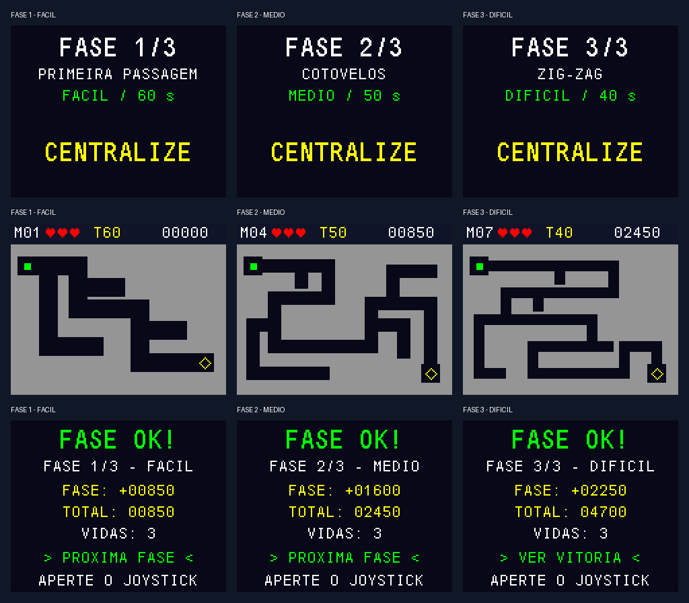
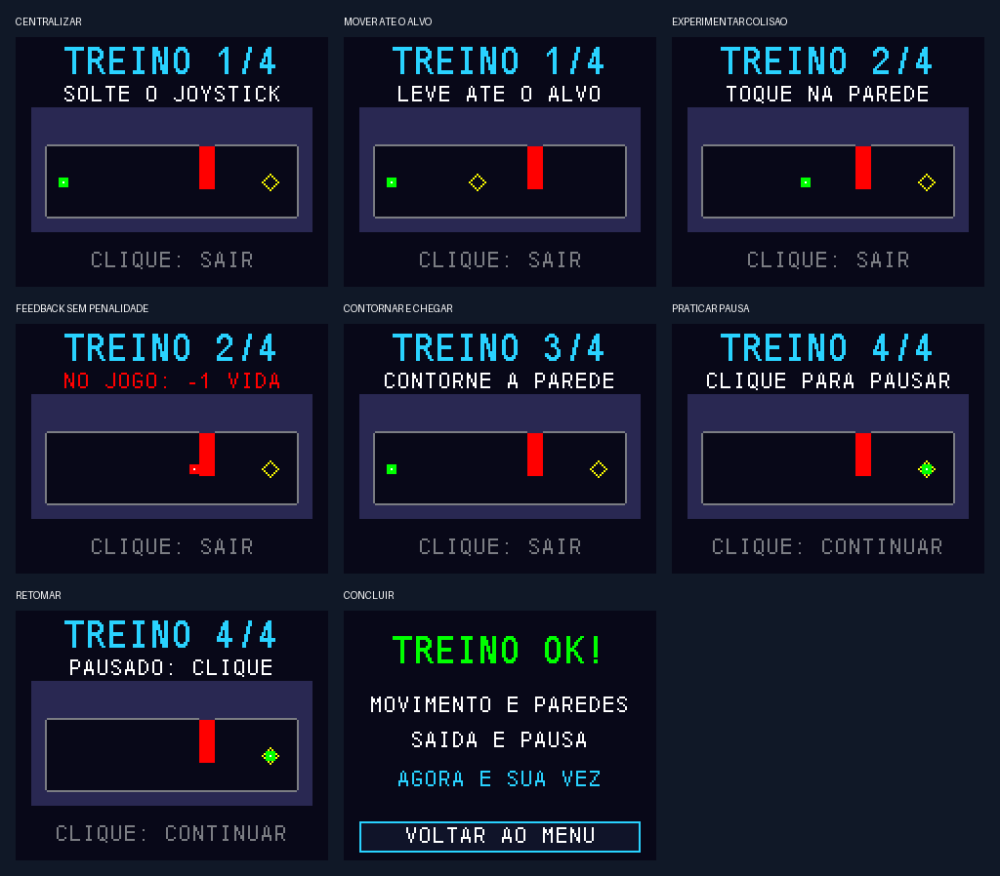

# Labirinto de Precisão — Microcontroladores II

Jogo para STM32F411 com nove labirintos, joystick e display TFT. Conduza o ponto
até a saída sem tocar nas paredes. A campanha tem três dificuldades, três vidas,
cronômetro, pontuação, pausa e vitória final. **COMO JOGAR** abre um treino
interativo de movimento, colisão, desvio e pausa, sem penalidades.

**Versão atual: TUTORIAL v0.4 — 03/11/2026.** O aluno confirmou a conclusão dos
nove mapas da versão anterior sem problemas até o momento. O tutorial desta
revisão está testado no computador e aguarda teste na placa. Áudio ainda pendente.

## Visão geral do projeto

- **Disciplina:** Microcontroladores II, IFSC; projeto individual.
- **Microcontrolador alvo:** STM32F411CEU6, HSI/PLL a 96 MHz.
- **Display:** módulo 1.8 TFT SPI 128×160 V1.1, ST7735 em paisagem 160×128.
- **Entrada:** joystick analógico X/Y e botão; ADC com DMA circular.
- **Sistema:** FreeRTOS, tarefas separadas de entrada, jogo e desenho.
- **Base:** enunciado e `Game_Start2_STM32F411CE` fornecidos pelo professor.



Prévias produzidas pelo renderizador C com display simulado; não são fotos da
montagem. Consulte o [relatório técnico](docs/RELATORIO.md) e o
[roteiro de entrega](docs/ENTREGA.md) para resultados e pendências.

## Conexões de hardware

- **TFT:** VCC e LED → 3V3; GND → G; CS → B12; RESET → B13; A0/DC → B14;
  SDA/MOSI → A7; SCK → A5.
- **Joystick:** +5V do módulo → **3V3**; GND → G; VRY → A0; VRX → A1; SW → C15.
- **ST-Link:** SWDIO/PA13, SWCLK/PA14 e GND comum; conferir alimentação da montagem.
- **Áudio:** PA8 reservado, buzzer e circuito ainda não definidos.

A0 do display é dados/comando e vai ao B14, não ao A0 do STM32. As ligações não
mudaram nesta versão. [Hardware detalhado](docs/HARDWARE.md).

## Começar: compilar e gravar

```sh
git clone https://github.com/mateusalgado/IFSC_MIC2.git
cd IFSC_MIC2/projeto-jogo
```

Para atualizar um clone existente, executar `git pull --ff-only` na pasta do
repositório, preservando eventuais alterações locais.

1. Importar **somente** `Game_Start2_STM32F411CE` como projeto existente no CubeIDE.
2. Usar Refresh → Project → Clean → Build Project, configuração Debug.
3. Manter `APP_DIAGNOSTIC=0` em `Core/Inc/game_config.h`.
4. Selecionar o `.elf` recém-compilado no Run/Debug e gravar com ST-Link.
5. Soltar o joystick durante a calibração. Conferir **TUTORIAL v0.4** no título.

Não é necessário regenerar o `.ioc` para compilar. Para alterar periféricos,
seguir [configuração e regeneração](docs/REGENERACAO.md), incluindo a correção
documentada do protótipo de hook emitido pelo CubeMX 6.18.

Alternativa com Python 3 e GNU Arm Embedded:

```sh
python3 scripts/check_config.py
python3 scripts/build_base.py
```

No Windows, usar `python` e, se necessário, `--cc 'C:\caminho\arm-none-eabi-gcc.exe'`.
Saídas: `build/campanha/labirinto-campanha.elf`, `.hex` e `.bin`. O script não grava
a placa. No CubeProgrammer, programar o `.hex` com verificação; para `.bin`,
usar endereço **0x08000000**. O artefato do GitHub Actions é
**mic2-labirinto-campanha**. `--diagnostic` gera o teste isolado de tela/joystick
em `build/diagnostico/`, artefato **mic2-diagnostico-spi1**.

## Como jogar

Cima/baixo seleciona JOGAR ou COMO JOGAR; clique confirma. No treino, centralize
o joystick, leve o ponto ao alvo, experimente tocar na parede, contorne o
obstáculo e pratique pausar/retomar. Durante os exercícios, o botão permite sair.



Na campanha, o ponto inteiro deve entrar na saída. Colisão perde uma vida;
o tempo por tentativa é 60/50/40 segundos nos níveis fácil/médio/difícil.
Clique pausa; no resultado, clique avança ao próximo mapa. As três vidas são
compartilhadas pelos nove mapas. [Regras, pontos e controles](docs/CAMPANHA.md).

## Estrutura do código e funcionalidades

Os arquivos abaixo ficam em `Game_Start2_STM32F411CE/`.

- `Core/Src/main.c`: inicialização HAL, clock, GPIO, SPI, ADC/DMA e bootstrap.
- `Core/Src/app_game.c`: tarefas FreeRTOS, filas, snapshots e diagnóstico de execução.
- `Core/Src/joy_input.c`: calibração, filtro, zona morta e debounce.
- `Core/Src/maze_game.c`: estados, movimento, vidas, pontuação e tutorial.
- `Core/Src/maze_map.c` e `maze_mapdata.c`: colisão e catálogo de mapas constantes.
- `Core/Src/game_renderer.c`: telas, HUD e atualização parcial do display.
- `Core/Src/st7735.c` e `fonts.c`: driver SPI e fontes herdados/adaptados da base.

Na raiz de `projeto-jogo/`, `assets/maps/` contém as plantas JSON;
`scripts/generate_map.py` valida e gera os dados C; `tests/` contém os testes.

Entrada, jogo e desenho executam nominalmente a cada 10/10/33 ms. Só a tarefa
de desenho acessa o display; callbacks ADC publicam amostras sem desenhar.
O [relatório](docs/RELATORIO.md) explica prioridades, filas, memória e estados.

## Testes e documentação

Com Python 3 e GCC/Clang em Linux/WSL:

```sh
python3 scripts/check_config.py
python3 scripts/generate_map.py --check
python3 scripts/test_host.py --sanitize
```

O CI executa essas verificações e compila jogo e diagnóstico. Os testes incluem
o percurso pelos nove mapas e pelo tutorial. Não substituem medições físicas.

- [Relatório técnico](docs/RELATORIO.md): objetivos, arquitetura, implementação e resultados.
- [Entrega e apresentação](docs/ENTREGA.md): documentos, evidências e roteiro de demonstração.
- [Campanha e teste da versão atual](docs/CAMPANHA.md).
- [Diagnóstico de bancada](docs/TESTE_BANCADA.md).
- [Requisitos e situação](docs/ESCOPO.md).
- [Plano de implementação](docs/PLANO_LABIRINTO.md) e [plano visual](docs/PLANO_VISUAL.md).
- [Enunciado](referencias/Projeto_uC_II_2026_02.pdf), [base do professor](docs/BASE_PROFESSOR.md)
  e [origem dos materiais](referencias/ORIGEM.md).

## Referências e créditos

A organização segue os READMEs de
[MIC1](https://github.com/mateusalgado/IFSC_MICROCONTROLADORESI) e do
[exemplo OLED](https://github.com/mateusalgado/IFSC_MICROCONTROLADORESI/blob/master/apps/oled/README.md):
visão geral, conexões, imagem, estrutura e funcionalidades, com instruções de uso.
O relatório e o registro de verificação complementam esse padrão para MIC2.
HAL, CMSIS, FreeRTOS, fontes e materiais do professor mantêm seus créditos e
licenças. O projeto do elevador permanece separado, em MAQ.