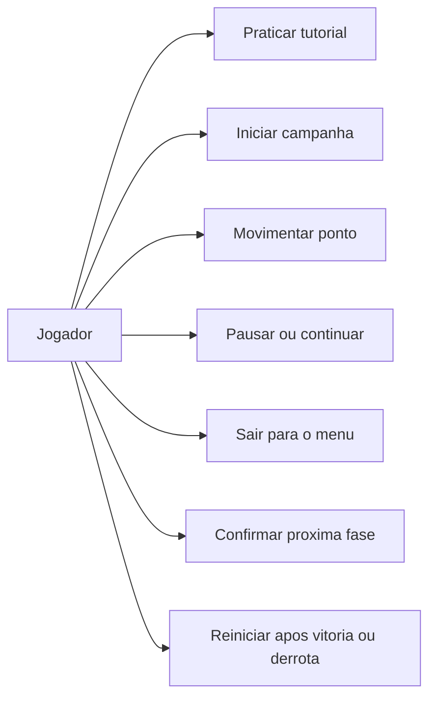

# 1. Análise do sistema

> Descrição do problema, requisitos, casos de uso e domínio do jogo.
>
> Página **1 de 4** · [Sumário](README.md)

---

## Descrição geral do domínio do problema

O Labirinto de Precisão é um jogo individual no qual o usuário movimenta um
ponto 5×5 pixels com um joystick e deve alcançar a saída de cada mapa sem
encostar nas paredes. Os nove mapas são plantas fixas, agrupadas em três
dificuldades. O ponto responde proporcionalmente à inclinação do joystick.

A partida começa após calibração e contagem regressiva. O jogador dispõe de
três vidas para toda a campanha. Colisões e tempo esgotado descontam vidas;
concluir um mapa soma pontos e permite avançar. Após M09, ocorre a vitória.
Quando as vidas acabam, aparece a derrota e o botão permite reiniciar.

## Requisitos funcionais

- **RF01 — Menu:** exibir título e permitir escolher JOGAR ou COMO JOGAR.
- **RF02 — Controle:** calibrar os eixos e movimentar o ponto pelo joystick.
- **RF03 — Campanha:** oferecer nove mapas, com três dificuldades.
- **RF04 — Regras:** detectar paredes/saída e controlar vidas, tempo e pontuação.
- **RF05 — Pausa:** permitir pausar, continuar ou sair para o menu.
- **RF06 — Encerramento:** exibir resultado, vitória/derrota e reiniciar pelo botão.
- **RF07 — Tutorial:** ensinar movimento, colisão, desvio e pausa com prática.
- **RF08 — Áudio:** apresentar sons. **Pendente** de buzzer, circuito e implementação.

RF01–RF07 estão implementados. A conclusão dos nove mapas na placa foi relatada
pelo aluno; o novo tutorial ainda aguarda reteste físico.

## Requisitos não funcionais

- **RNF01:** microcontrolador ARM com RTOS, conforme o enunciado.
- **RNF02:** separar aquisição, regras e desenho em tarefas com períodos definidos.
- **RNF03:** manter somente uma tarefa responsável pelo display SPI.
- **RNF04:** publicar dados de interrupção por APIs apropriadas, sem desenhar na ISR.
- **RNF05:** limitar esperas de periféricos e verificar falhas de alocação/pilha.
- **RNF06:** permitir testar regras e renderização sem depender da placa.
- **RNF07:** preservar pinagem, fontes e origem dos materiais da base do professor.

Os períodos configurados são metas de execução; latências e margens de memória
devem ser medidas na bancada. Aprovação docente ainda precisa ser registrada.

---

## Casos de uso

### UC01 — Jogar uma fase

**Ator:** jogador. **Pré-condição:** entrada calibrada, fase preparada e tela
confirmada pelo renderizador.

1. Inclinar o joystick para conduzir o ponto.
2. Firmware calcula deslocamento e verifica todo o percurso contra as paredes.
3. Ao alcançar a saída com o ponto inteiro, o jogo congela tempo/movimento,
   calcula pontos e mostra o resultado.
4. Um clique confirma a próxima fase ou a vitória final.

**Exceções:** parede ou timeout perde uma vida; falha técnica suspende o jogo
sem descontar vidas. Detalhes: [regras da campanha](docs/CAMPANHA.md).

### UC02 — Aprender em COMO JOGAR

**Pré-condição:** menu disponível. O jogador seleciona o treino, centraliza,
atinge um alvo, experimenta uma colisão, contorna a parede e pratica
pausa/retomada. O treino permite repetir erros sem alterar vidas ou pontuação.

### UC03 — Pausar e retomar

Durante a partida, clicar abre PAUSA. Selecionar CONTINUAR preserva posição,
mapa, vidas, pontos e relógio; SAIR encerra a campanha e retorna ao menu.

---

## Domínio do problema

- **Campanha:** sequência dos nove mapas e pontuação acumulada.
- **Mapa:** paredes, corredor, entrada, saída, dificuldade e limite de tempo.
- **Jogador/ponto:** posição e deslocamento controlados pelo joystick.
- **Tentativa:** tempo restante, colisões e timeouts do mapa atual.
- **Resultado:** pontos locais e total, vidas restantes e próxima fase.
- **Tutorial:** treino independente das penalidades da campanha.

Esses conceitos são representados por estruturas C e estados; a organização
documental de PROGOO foi reaproveitada sem impor classes/herança ao firmware.

**Referências:** [enunciado](referencias/Projeto_uC_II_2026_02.pdf),
[escopo](docs/ESCOPO.md) e [plano completo](docs/PLANO_LABIRINTO.md).

---

[Retroceder](README.md) | [Sumário](README.md) | **1 / 4** | [Avançar](projeto.md)

