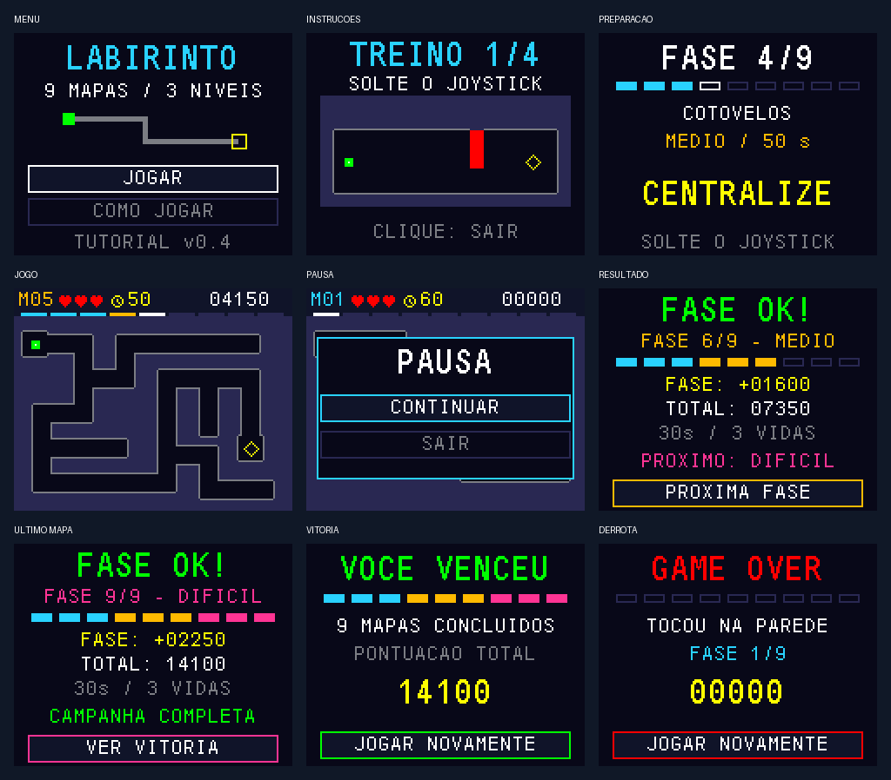

# Campanha de nove mapas — TUTORIAL v0.4

Atualizada em **03/11/2026**. O firmware padrão percorre nove mapas,
três por dificuldade, com resultado de cada fase, avanço pelo joystick,
pontuação acumulada e vitória final. Identificação na tela: **TUTORIAL v0.4**.

A pinagem e a aquisição de joystick do diagnóstico validado pelo aluno foram
preservadas. Em 03/11/2026, o aluno confirmou que concluiu os nove mapas da
versão anterior ao tutorial sem problemas até o momento. A versão v0.4 passou
nos testes do computador e na compilação ARM; **o novo tutorial aguarda teste na placa**.
O marco anterior de um mapa está registrado em [PRIMEIRO_MAPA.md](PRIMEIRO_MAPA.md);
a campanha intermediária de três fases está no commit `0b84598`.

## Nove mapas desta versão

A sequência é **M01 → M02 → M03 → M04 → M05 → M06 → M07 → M08 → M09**.
Três mapas por dificuldade; a dificuldade sobe após M03 e após M06.
As geometrias de M01, M04 e M07 foram preservadas em relação à v0.2.

**Fácil — corredores de 14 pixels, 60 s por tentativa:**

1. M01 — Primeira passagem: percurso central de 204 px, quatro curvas.
2. M02 — Quatro cantos: 244 px, quatro curvas.
3. M03 — Escolha a rota: 260 px, seis curvas.

**Médio — corredores de 10 pixels, 50 s por tentativa:**

4. M04 — Cotovelos: 356 px, sete curvas.
5. M05 — Desvio: 352 px, sete curvas.
6. M06 — Circuito interno: 380 px, seis curvas.

**Difícil — corredores de 8 pixels, 40 s por tentativa:**

7. M07 — Zig-zag: 500 px, onze curvas.
8. M08 — Precisão: 472 px, dez curvas.
9. M09 — Última saída: 492 px, oito curvas.

O ponto permanece 5×5 pixels, com velocidade máxima de 24 pixels/s e controle
proporcional. Entrada e saída têm câmaras de 14×14. Interseções/câmaras são mais
largas que os trechos retos. Cada JSON em `assets/maps/` define uma planta fixa,
com caminhos sem saída; não há geração aleatória no MCU.

O gerador valida o percurso para o ponto inteiro, curvas, comprimento, bordas,
metadados, diversidade das máscaras e alcançabilidade. Também rejeita um atalho
que reduza o menor caminho ortogonal a menos de 80% do percurso central.
Os menores caminhos entre centros são 204, 234, 232, 336, 332, 354, 482, 456 e
470 px. Essas medidas são de geometria; tempos e dificuldade percebida ainda
precisam ser medidos com pessoas jogando na placa.


## Interface e controles

- **Menu:** cima/baixo alterna JOGAR e COMO JOGAR; o botão confirma. Manter o
  eixo inclinado não repete a seleção; centralizar antes de selecionar novamente.
  A opção escolhida tem fundo destacado e uma borda que alterna a cada 500 ms.
- **COMO JOGAR:** tutorial jogável em arena própria. Centralize, leve o ponto
  ao alvo, experimente uma colisão, contorne a parede e pratique pausa/retomada.
  Não perde vidas nem concede pontos. Clique sai durante os exercícios; nas
  etapas finais pratica a pausa e confirma o retorno ao menu.
- **Preparação:** fase N/9, nome do mapa, dificuldade escrita, tempo e nove
  indicadores de progresso; centralização seguida de contagem 3–2–1.
- **Durante o jogo:** paredes escuras contornadas por dentro da máscara de colisão,
  ponto verde 5×5 com centro branco e saída em losango amarelo. A decoração não
  invade corredores nem modifica a área de colisão.
- **HUD:** número do mapa, três corações, ícone de relógio, segundos, pontos e
  nove segmentos de progresso. Tempo fica vermelho nos últimos cinco segundos.
- **Dificuldades:** ciano/fácil, âmbar/médio e rosa/difícil; texto acompanha as
  cores na preparação e no resultado. O mapa atual também tem marcador branco.
- **Pausa:** CONTINUAR/SAIR com seleção destacada, sem repetir movimento do eixo.
- **Resultado:** pontos locais e acumulados, tempo ativo acumulado, vidas,
  progresso e dificuldade da próxima fase. A nona fase indica campanha completa.
- **Fim:** vitória após nove mapas ou derrota com fase alcançada, pontuação
  e JOGAR NOVAMENTE. Nova campanha sempre começa em M01.



Prévias do código C com display simulado em 160×128, ampliadas sem suavização.
Pontuações de exemplo usam 30 segundos por mapa sem erros; não são fotos ou
resultados de partidas físicas. Ícones e elementos gráficos são pequenos
bitmaps/primitivas do código, sem imagens externas ou novas fontes.

## Regras de passagem e pontuação

- A campanha começa com **três vidas no total**. Avançar de fase não repõe vidas.
- Encostar na parede desconta uma vida e volta à entrada do mapa atual,
  preservando seu tempo restante. Tempo esgotado desconta uma vida e reinicia
  o limite da tentativa conforme a dificuldade: 60, 50 ou 40 segundos.
- A saída exige que o ponto inteiro esteja dentro da câmara. Ao alcançá-la,
  calcula-se a pontuação uma vez e abre-se **FASE OK!** com pontos dessa fase,
  total acumulado e vidas restantes. Cronômetro e movimento ficam congelados.
- Soltar e pressionar o joystick confirma **PROXIMA FASE**. A nova fase limpa
  apenas seu tempo ativo e penalidades locais, recebe seu limite de tempo e
  espera joystick centralizado e contagem 3–2–1. O display precisa confirmar a
  cena antes de aceitar avanço ou começar movimento; cliques durante a troca
  de tela não pulam a preparação.
- Na nona fase, **VER VITORIA** mostra **VOCE VENCEU / 9 MAPAS CONCLUIDOS**.
  Um novo clique reinicia desde M01 com três vidas e pontuação zero.
- Derrota em qualquer fase mostra o motivo, a fase alcançada e os pontos dos
  mapas concluídos. O mapa incompleto não concede pontos. Reiniciar começa M01.
- Pausa mantém fase, posição, vidas, pontos e relógio. SAIR encerra a campanha
  e volta ao título; iniciar novamente zera a campanha.

Para dificuldade D=1/2/3, limite T=60/50/40 e tempo ativo acumulado t em segundos
arredondados para cima:

```text
pontos_fase = max(0,
    500*D + 5*D*max(0,T-t)
    + (200*D se não houve colisão nem timeout)
    - 100*D*colisões - 200*D*timeouts)
pontos_total = soma das fases concluídas
```

As tentativas do mesmo mapa acumulam tempo ativo e penalidades. Pausa, resultado,
contagem e efeito de colisão não contam. Exemplos verificados nos testes:
fácil/30s/sem erro = 850; médio/30s/uma colisão = 1000;
difícil/55s acumulados/um timeout = 900 pontos.

## Atualizar, compilar e gravar

Na outra máquina, dentro do clone:

```sh
git pull --ff-only
```

Preservar mudanças locais antes de resolver qualquer conflito. No STM32CubeIDE:

1. Abrir somente `projeto-jogo/Game_Start2_STM32F411CE`.
2. Executar **Refresh → Project → Clean → Build Project**.
3. Manter `APP_DIAGNOSTIC=0` em `Core/Inc/game_config.h`.
4. Conferir que Run/Debug aponta para o `.elf` recém-compilado desse projeto.
5. Gravar com ST-Link; se parar no início da depuração, usar Resume.
6. Deixar o joystick solto ao iniciar e conferir **TUTORIAL v0.4** no título.

O `.ioc` está alinhado ao HSI/PLL de 96 MHz e aos periféricos do firmware.
Não é necessário gerar código para compilar; quando houver alteração de
configuração, seguir [REGENERACAO.md](REGENERACAO.md), incluindo o ajuste de
compatibilidade de hook do CubeMX 6.18. Os fios permanecem iguais.
Ver [HARDWARE.md](HARDWARE.md).

Alternativa com Python 3 e GNU Arm Embedded, a partir de `projeto-jogo`:

```sh
python3 scripts/build_base.py
```

Se necessário, passar `--cc` com o caminho de `arm-none-eabi-gcc.exe`.
Saídas atuais:

- `build/campanha/labirinto-campanha.elf`
- `build/campanha/labirinto-campanha.hex`
- `build/campanha/labirinto-campanha.bin`

O GitHub Actions entrega o artefato **mic2-labirinto-campanha**. Gravar o `.hex`
com verificação no CubeProgrammer; se usar `.bin`, endereço **0x08000000**.
Arquivos antigos `labirinto-mapa01.*` e `base-professor.*` não são esta campanha.
A opção `--diagnostic` continua produzindo `diagnostico-spi1.*` e o artefato
**mic2-diagnostico-spi1**, para teste isolado de tela/joystick.

## Implementação e verificações

- Catálogo imutável `MazeMap`: nove máscaras de 2240 bytes, **20160 bytes de
  geometria na Flash**, além dos metadados. Colisão e desenho usam o mesmo mapa.
- Snapshot `Game` leva índice da fase, pontos locais e total; apenas a tarefa
  de lógica altera a campanha. Mantidas três tarefas, filas e dono único do SPI.
- Estado `GAME_RESULT`: pontuação é concedida somente ao sair de
  `GAME_PLAYING`; confirmação do resultado avança uma única fase ou abre vitória.
- Renderizador usa entrada, saída, nome e limite do catálogo. O HUD identifica
  M01 até M09; preparação e resultado mostram fase N/9.
- `GAME_HELP` contém oito etapas internas de treinamento; `title_choice` faz parte do
  snapshot. Mantidos a liberação do eixo e o evento único de clique.
- Restauração parcial do fundo e losango da saída verificada nos nove mapas.

Com Python 3 e GCC/Clang (Linux/WSL), a partir de `projeto-jogo`:

```sh
python3 scripts/check_config.py
python3 scripts/generate_map.py --check
python3 scripts/test_host.py --sanitize
```

Resultados desta revisão: **8348 verificações** da lógica/entrada/geometria,
percurso completo pelos nove mapas, conservação de vidas e pontos, penalidades,
pausa, timeout por dificuldade, derrota em fase posterior, confirmação de tela,
vitória, reinício e percurso do tutorial sem alterar vidas/pontos. Também passaram testes dos onze estados visuais, limites de
texto, equivalência entre quadro completo e atualização parcial nos menus,
contagem, pausa, alerta de tempo e mapas, além do driver SPI simulado, com ASan/UBSan.
O teste percorre os mapas pela máquina de estados usando caminhos descobertos
por BFS sobre as máscaras compiladas; não depende da rota sugerida no JSON.
Os testes do computador não simulam os tempos do escalonador nem a montagem.

A prévia pode ser reproduzida após os testes com
`python3 scripts/preview_campaign.py` (Pillow necessário apenas para a imagem).

Compilação ARM local com GCC 14.3.1, 48 objetos, `-O0 -Wall`, sem avisos:

- Campanha: text 76360, data 120 e bss 24272 bytes.
- Diagnóstico: text 32292, data 104 e bss 21616 bytes.

BSS inclui heap reservado do RTOS e não mede uso máximo durante o jogo. Verificar
na placa `game_input_stack_free`, `game_logic_stack_free`, `game_render_stack_free`
(em palavras), `game_min_free_heap` (bytes) e `game_late_ticks`.

## Roteiro de bancada e registro

A conclusão dos nove mapas da versão anterior foi confirmada pelo aluno,
sem problemas relatados. Os itens abaixo orientam o reteste específico de v0.4;
não representam falhas observadas.

- [ ] Identificação **TUTORIAL v0.4**, commit gravado e calibração concluída.
- [ ] Cima/baixo seleciona JOGAR/COMO JOGAR; tutorial abre e retorna corretamente.
- [ ] Tutorial: centralizar, alvo, colisão, desvio, pausa, retomada e conclusão.
- [ ] Erro no treino permite repetir; sair/reentrar e iniciar campanha funciona.
- [ ] Orientação correta e parada imediata ao soltar o joystick.
- [ ] M01, M02 e M03 acessíveis em sequência, com 60 s cada.
- [ ] M03 → M04 muda para médio/50 s; M04, M05 e M06 acessíveis.
- [ ] M06 → M07 muda para difícil/40 s; M07, M08 e M09 acessíveis.
- [ ] Vidas e pontos preservados entre todas as fases, sem reposição de vidas.
- [ ] M09 concluído; resultado, vitória final e reinício em M01 funcionam.
- [ ] Uma colisão desconta exatamente uma vida em cada dificuldade.
- [ ] Timeout restaura 60/50/40 s conforme o mapa quando ainda resta vida.
- [ ] Pausa/retomada não mudam fase, posição ou tempo restante.
- [ ] Derrota em fase posterior mantém pontos anteriores; reinício zera tudo.
- [ ] Botão segurado não pula fases e não duplica pontos.
- [ ] Contraste de paredes/ponto, leitura do HUD e seleção do menu confortáveis.
- [ ] Registrar fotos/vídeo, tempos de conclusão e dificuldade de cada mapa.
- [ ] Sessão contínua de 30 minutos e medições de pilha/heap/atrasos.

**Pendências:** reteste físico do tutorial/regeneração, áudio (buzzer/circuito
ainda não escolhidos), aprovação da ideia e medições para fechar o
[relatório](RELATORIO.md). O [roteiro de entrega](ENTREGA.md) reúne os documentos
e evidências necessárias. Mascote e animações adicionais são opcionais.
