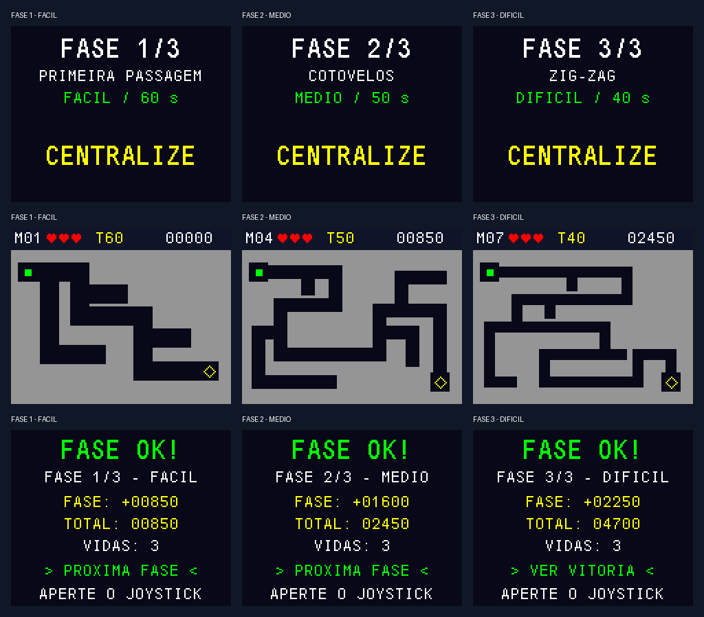

# Campanha de três fases — v0.2

Atualizada em **03/11/2026**. O firmware padrão agora percorre três mapas:
fácil → médio → difícil, com resultado de cada fase, avanço pelo joystick,
pontuação acumulada e vitória final. Identificação na tela: **3 FASES v0.2**.

A pinagem e a aquisição de joystick do diagnóstico validado pelo aluno foram
preservadas. Os testes desta campanha foram executados no computador e a
compilação ARM foi verificada; **o ensaio desta versão na placa está pendente**.
O marco anterior de um mapa está registrado em [PRIMEIRO_MAPA.md](PRIMEIRO_MAPA.md).

## Mapas desta versão

1. **Fase 1/3 — M01, Primeira passagem, fácil:** corredores de 14 pixels,
   60 segundos, percurso central de 204 pixels e quatro curvas.
2. **Fase 2/3 — M04, Cotovelos, médio:** corredores de 10 pixels,
   50 segundos, percurso central de 356 pixels e sete curvas.
3. **Fase 3/3 — M07, Zig-zag, difícil:** corredores de 8 pixels,
   40 segundos, percurso central de 500 pixels e onze curvas.

Os identificadores M01/M04/M07 preservam a organização do plano de nove mapas.
Nesta versão, **avançar em M01 leva diretamente a M04 e depois a M07**; não há
seis fases ocultas. O ponto permanece 5×5 pixels, com velocidade máxima de
24 pixels/s e controle proporcional. Entrada e saída têm câmaras de 14×14.
As interseções/câmaras são mais largas que os trechos retos dos corredores.

Cada arquivo JSON em `assets/maps/` define geometria, entrada, saída, nome,
dificuldade e limite. O gerador valida o percurso para o ponto inteiro e uma
busca de alcançabilidade. Os menores percursos ortogonais entre os centros são
204, 336 e 482 pixels; o jogador pode cortar curvas dentro da área livre.
Essas medidas verificam geometria, **não representam tempo medido na placa**.



Prévia gerada pelos testes com painel simulado em 160×128, ampliada sem suavização.
Pontuações de exemplo usam 30 segundos por mapa sem erros; não são fotografias
nem resultados de partidas físicas.

## Regras de passagem e pontuação

- A campanha começa com **três vidas no total**. Avançar de fase não repõe vidas.
- Encostar na parede desconta uma vida e volta à entrada do mapa atual,
  preservando seu tempo restante. Tempo esgotado desconta uma vida e reinicia
  o limite da tentativa conforme a dificuldade: 60, 50 ou 40 segundos.
- A saída exige que o ponto inteiro esteja dentro da câmara. Ao alcançá-la,
  calcula-se a pontuação uma vez e abre-se **FASE OK!** com pontos dessa fase,
  total acumulado e vidas restantes. Cronômetro e movimento ficam congelados.
- Soltar e pressionar o joystick confirma **PROXIMA FASE**. A nova fase limpa
  apenas seu tempo ativo e penalidades locais, recebe seu limite de tempo e
  espera joystick centralizado e contagem 3–2–1. O display precisa confirmar a
  cena antes de aceitar avanço ou começar movimento; cliques durante a troca
  de tela não pulam a preparação.
- Na terceira fase, **VER VITORIA** mostra **VOCE VENCEU / 3 FASES CONCLUIDAS**.
  Um novo clique reinicia desde M01 com três vidas e pontuação zero.
- Derrota em qualquer fase mostra o motivo, a fase alcançada e os pontos dos
  mapas concluídos. O mapa incompleto não concede pontos. Reiniciar começa M01.
- Pausa mantém fase, posição, vidas, pontos e relógio. SAIR encerra a campanha
  e volta ao título; iniciar novamente zera a campanha.

Para dificuldade D=1/2/3, limite T=60/50/40 e tempo ativo acumulado t em segundos
arredondados para cima:

```text
pontos_fase = max(0,
    500*D + 5*D*max(0,T-t)
    + (200*D se não houve colisão nem timeout)
    - 100*D*colisões - 200*D*timeouts)
pontos_total = soma das fases concluídas
```

As tentativas do mesmo mapa acumulam tempo ativo e penalidades. Pausa, resultado,
contagem e efeito de colisão não contam. Exemplos verificados nos testes:
fácil/30s/sem erro = 850; médio/30s/uma colisão = 1000;
difícil/55s acumulados/um timeout = 900 pontos.

## Atualizar, compilar e gravar

Na outra máquina, dentro do clone:

```sh
git pull --ff-only
```

Preservar mudanças locais antes de resolver qualquer conflito. No STM32CubeIDE:

1. Abrir somente `projeto-jogo/Game_Start2_STM32F411CE`.
2. Executar **Refresh → Project → Clean → Build Project**.
3. Manter `APP_DIAGNOSTIC=0` em `Core/Inc/game_config.h`.
4. Conferir que Run/Debug aponta para o `.elf` recém-compilado desse projeto.
5. Gravar com ST-Link; se parar no início da depuração, usar Resume.
6. Deixar o joystick solto ao iniciar e conferir **3 FASES v0.2** no título.

**Não regenerar pelo `.ioc` ainda:** a divergência HSE/HSI herdada permanece
pendente. O código compilado preserva o HSI/PLL a 96 MHz da base testada.
Não foi necessário mudar fios. Ver [HARDWARE.md](HARDWARE.md).

Alternativa com Python 3 e GNU Arm Embedded, a partir de `projeto-jogo`:

```sh
python3 scripts/build_base.py
```

Se necessário, passar `--cc` com o caminho de `arm-none-eabi-gcc.exe`.
Saídas atuais:

- `build/campanha/labirinto-campanha.elf`
- `build/campanha/labirinto-campanha.hex`
- `build/campanha/labirinto-campanha.bin`

O GitHub Actions entrega o artefato **mic2-labirinto-campanha**. Gravar o `.hex`
com verificação no CubeProgrammer; se usar `.bin`, endereço **0x08000000**.
Arquivos antigos `labirinto-mapa01.*` e `base-professor.*` não são esta campanha.
A opção `--diagnostic` continua produzindo `diagnostico-spi1.*` e o artefato
**mic2-diagnostico-spi1**, para teste isolado de tela/joystick.

## Implementação e verificações

- Catálogo imutável `MazeMap`: três máscaras de 2240 bytes, **6720 bytes de
  geometria na Flash**, além dos metadados. Colisão e desenho usam o mesmo mapa.
- Snapshot `Game` leva índice da fase, pontos locais e total; apenas a tarefa
  de lógica altera a campanha. Mantidas três tarefas, filas e dono único do SPI.
- Novo estado `GAME_RESULT`: pontuação é concedida somente ao sair de
  `GAME_PLAYING`; confirmação do resultado avança uma única fase ou abre vitória.
- Renderizador usa entrada, saída, nome e limite do catálogo. O HUD identifica
  M01/M04/M07; preparação e resultado mostram fase 1/3, 2/3 ou 3/3.
- Restauração parcial do fundo e losango da saída verificada nos três mapas.

Com Python 3 e GCC/Clang (Linux/WSL), a partir de `projeto-jogo`:

```sh
python3 scripts/generate_map.py --check
python3 scripts/test_host.py --sanitize
```

Resultados desta revisão: **1838 verificações** da lógica/entrada/geometria,
percurso completo pelos três mapas, conservação de vidas e pontos, penalidades,
pausa, timeout por dificuldade, derrota em fase posterior, confirmação de tela,
vitória e reinício. Também passaram testes dos dez estados visuais, limites de
texto, atualização parcial/completa e driver SPI simulado, com ASan/UBSan.
Os testes do computador não simulam os tempos do escalonador nem a montagem.

A prévia pode ser reproduzida após os testes com
`python3 scripts/preview_campaign.py` (Pillow necessário apenas para a imagem).

Compilação ARM local com GCC 14.3.1, 48 objetos, `-O0 -Wall`, sem avisos:

- Campanha: text 57124, data 120 e bss 24264 bytes.
- Diagnóstico: text 32228, data 104 e bss 21616 bytes.

BSS inclui heap reservado do RTOS e não mede uso máximo durante o jogo. Verificar
na placa `game_input_stack_free`, `game_logic_stack_free`, `game_render_stack_free`
(em palavras), `game_min_free_heap` (bytes) e `game_late_ticks`.

## Roteiro de bancada e registro

- [ ] Identificação **3 FASES v0.2**, commit gravado e calibração concluída.
- [ ] Orientação correta e parada imediata ao soltar o joystick.
- [ ] M01 concluído; resultado exibe pontos e confirmação leva a M04.
- [ ] M04 inicia com 50 s, corredor mais estreito e vidas/pontos preservados.
- [ ] M04 concluído; confirmação leva a M07 com 40 s.
- [ ] M07 concluído; resultado, vitória final e reinício em M01 funcionam.
- [ ] Uma colisão desconta exatamente uma vida em cada dificuldade.
- [ ] Timeout em M04/M07 restaura 50/40 s quando resta vida; total preservado.
- [ ] Pausa/retomada não mudam fase, posição ou tempo restante.
- [ ] Derrota em fase posterior mantém pontos anteriores; reinício zera tudo.
- [ ] Botão segurado não pula fases e não duplica pontos.
- [ ] Registrar fotos/vídeo, tempos de conclusão e observações de dificuldade.
- [ ] Sessão contínua de 30 minutos e medições de pilha/heap/atrasos.

**Pendências:** ensaio físico e ajuste de dificuldade, seis mapas restantes,
áudio (buzzer/circuito ainda não escolhidos), acabamento visual, reconciliação
do `.ioc`, aprovação da ideia e relatório final com resultados medidos.
