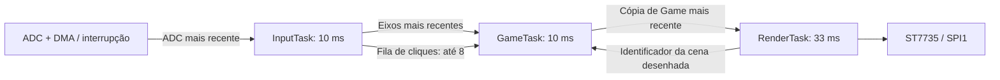

# Comparação com a base do professor e refatoração didática

Análise e refatoração em **24/11/2026**. A proposta é deixar o programa legível
para um primeiro projeto com RTOS, preservando a campanha de nove mapas,
o tutorial e a decisão de não usar buzzer.

## Qual base foi usada

A referência é o [ZIP original](../referencias/Game_Start2_STM32F411CE.zip),
SHA-256 `0130a2994b2002d8e184d69a591b900be8716b7981480139348a8c594157b3cb`.
O import original também está no commit `02aed85`; a versão imediatamente
anterior a esta refatoração está no commit `821b5e0`.

São duas comparações diferentes:

- **Professor → jogo atual:** mostra tudo que foi desenvolvido sobre o exemplo.
- **Jogo anterior → refatoração:** mostra mudanças de organização e legibilidade,
  a separação do diagnóstico, os novos testes de integração e uma correção no driver.

O [inventário de arquivos, funções e tipos](comparacao/INVENTARIO.md) é gerado
automaticamente. O [JSON completo](comparacao/inventario.json) registra hashes,
assinaturas, linhas, includes, typedefs e chamadas diretas do Core/Legacy.
Foram examinados todos os arquivos C e headers da base e do firmware atual.
A leitura detalhada concentra-se na aplicação e na sua integração: as milhares
de funções internas das bibliotecas são inventariadas, não reimplementadas nem
certificadas individualmente. O parser não expande macros; suas limitações
ficam registradas por arquivo. A compilação ARM valida a configuração ativa.

## O que foi preservado e o que mudou

Os **51 arquivos da HAL**, **35 de CMSIS/dispositivo** e **34 de FreeRTOS e seu
adaptador** são idênticos aos do ZIP. O projeto não ganhou outra biblioteca
de firmware. Seis arquivos didáticos sem uso foram movidos, sem alterar bytes,
para `Legacy`. Não há arquivos da base removidos sem correspondência.

Seis arquivos originais têm conteúdo diferente do ZIP:

- `main.c`: saiu a demonstração de soldados; ficaram inicialização, publicação
  ADC e partida da aplicação/diagnóstico.
- `freertos.c`: hooks de falha de alocação e de estouro de pilha.
- `FreeRTOSConfig.h`: opções de diagnóstico e consultas de memória.
- `st7735.c` e `st7735.h`: operações de desenho com limites, transferências SPI
  com timeout e registro de falha; nesta refatoração, correção de buffer numérico.
- `.ioc`: alinhamento com HSI/PLL, ADC/DMA e opções RTOS utilizadas pelo código.

A aplicação acrescenta **sete headers e sete fontes C novos** em relação
ao ZIP. Os READMEs acrescentados explicam a navegação e a pasta Legacy.

### Como era o exemplo

O `main.c` original reúne `vTask_Move_Soldado`, `vTask_Print_Soldado`,
`vTask_Print_ValorADC` e o callback ADC. Há espera ocupada pelo botão antes do
scheduler e múltiplas tarefas acessando o display. Serve para demonstrar
periféricos e tarefas; ainda não tem as regras da campanha atual.

O código gerado usa HSI/PLL de 96 MHz, mas o `.ioc` original declara HSE.
Essa divergência já havia sido reconciliada antes desta refatoração.
O SPI original espera com `HAL_MAX_DELAY`; o driver atual limita a espera
e registra o erro. A [análise histórica](BASE_PROFESSOR.md) conserva os detalhes
de cada etapa, sem confundir essas melhorias anteriores com o trabalho atual.

### O que esta refatoração alterou

- Funções e variáveis internas receberam nomes que explicam sua finalidade.
  Blocos compactados foram expandidos e condições usam chaves explícitas.
- `Game_Tick` despacha para rotinas de atualização por estado; `Renderer_Draw`
  despacha para rotinas de desenho por tela. Regras e desenho continuam separados.
- Prioridades, tamanhos de pilha, capacidade de fila e limites de tempo da
  integração têm constantes nomeadas junto às tarefas.
- `main.c` deixou de conter o desenho e o laço do diagnóstico. Essa aplicação
  alternativa fica em `app_diagnostic.c`, selecionada na compilação.
- PRNG, atrasos por laço e figuras antigas foram para `Legacy`, fora do build.
- A função herdada `ST7735_write_nr` usava dez bytes e `sprintf`. Para
  `-2147483648`, são necessários doze bytes com o terminador. Agora usa
  doze bytes e `snprintf`; um teste de regressão cobre os extremos de `int`.
- Os testes passaram a exercitar os corpos reais das tarefas com filas e
  relógio controlados, além dos testes já existentes de lógica e desenho.

Não houve alteração intencional nas regras, mapas, pontuação, velocidade,
pinagem, períodos ou prioridades. A versão exibida continua `TUTORIAL v0.4`.

## Bibliotecas: para que servem neste projeto

**HAL STM32F4, versão 1.8.5:** configura e opera ADC, DMA, GPIO, SPI, RCC e TIM.
As chamadas principais são `HAL_Init`, `HAL_ADC_Start_DMA`, `HAL_GPIO_ReadPin`,
`HAL_GPIO_TogglePin`, `HAL_SPI_Transmit` e `HAL_GetTick`. A aplicação usa essas
interfaces; não precisa modificar a implementação da ST para aprender RTOS.

**CMSIS e arquivos do dispositivo:** descrevem registradores, núcleo Cortex-M4,
interrupções e inicialização. `SystemInit`, startup e linker preparam o programa
antes de `main`. `stm32f4xx_it.c` encaminha DMA2_Stream0 e TIM4 à HAL.
TIM4 mantém o tempo HAL; o port FreeRTOS administra as exceções do scheduler.

**FreeRTOS V10.3.1:** fornece tarefas, filas, espera periódica, seções críticas
e alocação. O build usa o port GCC ARM_CM4F e `heap_4.c`.
`tasks.c` cuida das tarefas; `queue.c`, das filas; `list.c`, das listas internas;
`timers.c` e `event_groups.c` estão disponíveis, mas não são mecanismos usados
diretamente pelo jogo. O catálogo não significa que toda função é ligada ao ELF.

**CMSIS-RTOS v2:** adaptador que o CubeMX usa para `osKernelInitialize`,
`osThreadNew` e `osKernelStart`. A tarefa inicial chama `App_Start` e se exclui.
As três tarefas do jogo usam a API nativa FreeRTOS. A mistura fica restrita
a essa fronteira; valores de prioridade e unidades de pilha das duas APIs
não devem ser confundidos.

**ST7735 e fontes:** driver de display herdado e adaptado, com comunicação
SPI bloqueante. `fonts.c` contém dados constantes de caracteres, não lógica
de jogo. `FontDef` descreve largura, altura e ponteiro dos glifos.
`FigDef` permanece na interface do driver para as funções de figuras, mesmo
que os desenhos antigos não sejam usados pelo jogo.

**Biblioteca C do compilador:** `stdint.h` e `stdbool.h` tornam tipos explícitos;
`string.h` fornece inicialização/cópia/comparação de memória;
`stdio.h` fornece `snprintf` para textos limitados pelo tamanho do buffer.
`syscalls.c` e `sysmem.c` são suporte do runtime, não classes da aplicação.
Os pacotes Python do inventário são ferramentas de análise no computador e
não entram no firmware.

## Classes, estruturas e funções

Este é um projeto **C**, sem classes C++. A organização usa módulos `.c/.h`,
estruturas para dados e `enum` para estados. Funções auxiliares `static` ficam
privadas ao arquivo; os headers expõem somente a interface necessária.

### Entrada e integração RTOS

`AdcSample` leva X/Y brutos e instante da leitura. `JoystickSample` leva eixos
normalizados, validade, calibração e instante da publicação. São tipos internos
de `app_game.c`, pois representam mensagens entre suas tarefas.

- `App_Start`: cria cinco filas e três tarefas; verifica cada criação. É chamado
  uma vez durante a inicialização, não para reiniciar uma partida.
- `App_AdcFromISR`: publica uma cópia do par ADC usando `xQueueOverwriteFromISR`.
  Não espera e não desenha.
- `InputTask`: lê a amostra, verifica idade, consulta o botão e chama `Joy_Update`.
- `ReadGameInput`: reúne eixos, cliques e confirmação do display.
- `CheckGameFaults` e `RegisterFault`: propagam erros e preservam a primeira falha.
- `GameTask`: mantém o único `Game` mutável, atualiza regras e publica uma cópia.
- `RenderTask`: inicializa e opera o display; só confirma a cena se não houver erro SPI.

`Joy` guarda a memória da calibração, filtro e debounce. `JoyResult` entrega
X/Y entre −1000 e 1000, estado de calibração e um clique por pressionamento.
`Joy_Init` inicializa essa memória; `Joy_Update` chama as etapas internas
`UpdateButton`, `UpdateCalibration` e `NormalizeAxis`. `ResetCalibration`
reinicia o acúmulo quando a amostra não permite calibrar.

A calibração usa 100 amostras, exige centro entre 1024 e 3072 e variação máxima
de 160 unidades. O filtro usa aritmética inteira; a zona morta é de 10%.
O debounce exige três amostras estáveis e liberação antes de armar o clique.

### Regras da partida

`GameState` enumera os onze estados. `TutorialStep` enumera oito etapas de
treino. `GameReason` distingue colisão/tempo de falhas de entrada, display,
temporização e fila. `GameInput` é a entrada de um ciclo; `Game` reúne estado,
temporizadores, posição, vidas, pontuação, mapa e seleção dos menus.

- `Game_Init` inicializa; `Game_Tick` executa uma atualização; `Game_Fail`
  entra no estado de falha; `Game_X`/`Game_Y` convertem posição para pixels.
- `Game_Score` calcula pontos a partir de dificuldade, tempo e penalidades.
- `EnterState` troca o estado e incrementa `scene`, usado na confirmação do display.
- `StartCampaign`, `PrepareMap` e `PlaceAtStart` preparam partida/mapa/posição.
- `UpdateTitle`, `UpdateCountdown`, `UpdatePlaying`, `UpdatePause`, `UpdateHit`
  e `UpdateResult` deixam as regras de cada estado localizáveis.
- `UpdateTutorial`, `EnterTutorialStep` e `PlaceInTutorial` controlam o treino.
- `ApplyPenalty` registra a causa, desconta vida e seleciona impacto ou derrota.
- `CalculateDestination`, `IntegerSquareRoot` e `ToPixel` concentram matemática
  de movimento, normalização diagonal e arredondamento.

Esse módulo não chama HAL, FreeRTOS nem display. Pode ser lido e testado como
uma máquina de estados comum antes de estudar concorrência.
Posições usam milésimos de pixel: isso evita perder movimentos pequenos nos
ciclos de 10 ms. A normalização impede que a diagonal seja mais rápida.

### Mapas e colisão

`MazeMap` contém máscara constante de paredes, nome, limite de tempo,
dificuldade, entrada e saída. `maze_maps` contém os nove mapas;
`maze_tutorial` é uma arena separada.

- `Maze_Get`: consulta por índice de campanha, de 0 a 8.
- `Maze_Difficulty`: fornece o nome da dificuldade.
- `Maze_Wall`: consulta um bit da máscara e trata limites como parede.
- `Maze_Free`: verifica a área 5×5 inteira do jogador.
- `Maze_SweepFree`: verifica também o trajeto entre as posições, incluindo
  células vizinhas ao cruzar cantos na diagonal.
- `Maze_Exit`: exige que o jogador caiba na área de saída.

Cada máscara tem 2240 bytes: 160 × 112 pixels com um bit por pixel.
`maze_mapdata.c` contém dados gerados, não funções escritas manualmente.
Não simplificamos a colisão para consultar apenas o ponto final, pois isso
permitiria atravessar paredes entre dois ciclos.

### Apresentação e driver

`Renderer_Init` força o primeiro desenho completo. `Renderer_Draw` escolhe
a rotina `Draw...` correspondente ao estado. `DrawTutorial`, `DrawTitle`,
`DrawCountdown`, `DrawPlaying`, `DrawPause`, `DrawHit`, `DrawResult`,
`DrawEnding`, `DrawFault` e `DrawCalibration` organizam as telas.
`TutorialHint`, `TutorialLesson` e `FaultMessage` selecionam textos com
condições explícitas. Os demais auxiliares desenham texto centralizado,
contornos, ícones, corações, botões, progresso, jogador e barra superior.

`previous` é a cópia do último estado desenhado. `RestoreRegion` repõe o fundo
onde o jogador estava usando `BackgroundColor`; `DifficultyColor` escolhe a
cor da dificuldade. O buffer fixo contém oito linhas, 2560 bytes, em vez de
uma imagem completa de 40960 bytes. Isso reduz RAM e transferências SPI.
Toda essa memória pertence à tarefa de display.

No driver, as funções se agrupam em seleção/reset/comandos, inicialização,
pixel/texto, retângulos/imagens, inversão/gamma e primitivas antigas.
`ST7735_Transmit` limita a espera e mantém o erro consultado por
`ST7735_HasError`. `ST7735_write_nr` agora limita a formatação numérica.
O inventário lista todas as assinaturas, inclusive as primitivas não usadas
pela campanha. A revisão não transforma APIs herdadas em uma biblioteca
genérica capaz de aceitar qualquer argumento; os testes cobrem os casos
documentados de limites, recorte, SPI e formatação.

### Inicialização, diagnóstico e exemplos

`main` inicializa HAL, clock e periféricos e inicia o scheduler.
`SystemClock_Config` e `MX_*_Init` são configuração CubeMX.
`PublishAdcPair` calcula a média de 16 pares de uma metade concluída do DMA;
os callbacks de metade/fim publicam essa média. O DMA possui 64 meias-palavras,
com duas metades de 32; a CPU lê a metade já concluída.

`Diagnostic_Init`, `Diagnostic_AdcFromISR` e `Diagnostic_Run` formam a aplicação
alternativa de bancada. Ela mostra ADC, cursor e botão em uma tarefa, com
atualização nominal de 50 ms. É selecionada por `APP_DIAGNOSTIC=1` e não roda
concorrentemente com as tarefas do jogo.

Os arquivos de interrupções, timebase, hooks e suporte C têm suas funções
listadas no inventário. Em `Legacy`, `init_LFSR`/`prng_LFSR` e os três
`atraso_*` ficam disponíveis para consulta. Seus atrasos ocupados não são
usados para controlar o período das tarefas.

## Entendendo o fluxo RTOS



As quatro filas de tamanho 1 são caixas de valor mais recente: o consumidor
não precisa reproduzir posições antigas do joystick nem quadros atrasados.
A fila de cliques guarda eventos. O jogo reúne os cliques disponíveis em uma
ação por ciclo; encher a fila registra falha, em vez de perder eventos em silêncio.

Prioridades nativas: entrada **4**, jogo **3**, display **1**; número maior
significa maior prioridade. Pilhas: **256, 512 e 512 palavras de 32 bits**,
respectivamente. `osThreadNew`, usado só no bootstrap, recebe tamanho em bytes.
Não copie números entre essas APIs sem observar a unidade.

`vTaskDelayUntil` calcula o próximo período a partir do anterior e bloqueia
a tarefa, permitindo que outras executem. O display faz SPI bloqueante, mas
isso não autoriza outra tarefa a acessar o mesmo display. Por haver um único
dono do dispositivo, não há mutex de SPI na aplicação.

As filas copiam as mensagens. `GameTask` altera sua variável local e
`RenderTask` desenha outra cópia; não dividem um ponteiro mutável de partida.
`volatile` sozinho não resolveria essa comunicação. A seção crítica curta em
`RegisterFault` protege a escolha da primeira causa de erro.

Amostras com mais de 100 ms ficam inválidas. Sem entrada válida na partida,
a lógica entra em falha; na inicialização há tolerância de 1000 ms sem ADC.
Uma cena não confirmada por mais de 2000 ms também causa falha.
O contador de atrasos observa ciclos acima de 12 ms; durante movimento ou
tutorial, a lógica rejeita intervalos acima de 50 ms. Esses limites não são
medições de tempo real.

## Padrão de escrita para continuar o projeto

1. Mantenha C procedural, `enum`, `struct`, `if`, `switch` e funções de uma
   responsabilidade. Não é necessário introduzir classes, callbacks genéricos
   ou um framework para três tarefas.
2. Leia o `.h` primeiro. Use `static` para detalhes internos e nomes descritivos
   como `UpdatePlaying`, em vez de abreviações de uma letra para a partida.
3. Prefira blocos com chaves e condições explícitas. O `.clang-format` registra
   a formatação da aplicação; não reformate HAL, CMSIS, kernel ou mapas gerados.
4. Comente o motivo e a unidade: milissegundos, palavras de pilha, milésimos de
   pixel e propriedade das filas. Não é preciso comentar toda atribuição.
5. Deixe operações rápidas nos callbacks. Chamadas de ISR usam a variante
   `FromISR`; não coloque desenho, espera ou laços de jogo em interrupções.
6. Altere regras em `maze_game.c`, entrada em `joy_input.c`, visual em
   `game_renderer.c` e comunicação em `app_game.c`. Preserve regiões USER CODE
   dos arquivos gerados; siga o procedimento de regeneração antes de usar CubeMX.

Ordem sugerida de estudo: tipos em `maze_game.h`, uma partida em `Game_Tick`,
entrada em `Joy_Update`, fluxo de filas em `app_game.c`, desenho e, por último,
inicialização/DMA. Matemática de colisão e detalhes do driver podem ser estudados
separadamente sem esconder o funcionamento das tarefas.

## Verificação e limites

Executado nesta refatoração:

- **8348 verificações** da lógica, geometria, entrada, campanha, vidas,
  pontuação e temporização com AddressSanitizer e UndefinedBehaviorSanitizer.
- Testes do renderizador e do driver real ST7735 com transporte simulado.
  As **45 imagens PPM** geradas mantiveram exatamente os hashes anteriores.
- Sete cenários usando as funções reais das tarefas: fluxo normal, ausência
  de ADC, entrada envelhecida, erro de display, fila de cliques cheia e falhas
  de alocação de fila/tarefa. São execuções controladas, sem simular preempção.
- Compilação ARM de campanha e diagnóstico, com 46 objetos e `-O0 -Wall`.
- Contrato CubeMX/fontes e regeneração determinística das máscaras dos mapas.

Os números finais de memória desta execução ficam no
[registro de validação](VALIDACAO_REFATORACAO.md). Não representam margem de
pilha medida em execução. O hardware não foi conectado nesta sessão.
Faltam teste do tutorial e desta refatoração na placa, resposta do joystick,
fluidez/latência SPI e leitura dos mínimos de pilha/heap no debugger.
O teste anterior dos nove mapas relatado pelo aluno não cobre esta revisão.

## Reproduzir a comparação

A partir de `projeto-jogo`, com Python 3:

```sh
python -m pip install -r scripts/requirements-analysis.txt
python scripts/compare_professor.py
python scripts/compare_professor.py --check
```

O inventário considera o firmware; testes, mapas editáveis e documentação
externos a ele são materiais adicionais do projeto. Não é necessário instalar
esses pacotes Python para compilar no CubeIDE. O ZIP original permanece intacto.

Para separar as diferenças no Git:

```sh
git diff --stat 02aed85 HEAD
git diff 821b5e0 HEAD -- projeto-jogo/Game_Start2_STM32F411CE/Core
```

O primeiro comando mostra o histórico de desenvolvimento sobre a base; o
segundo isola esta refatoração depois que ela estiver registrada em commit.
Para alterações ainda não registradas, omita `HEAD` no segundo comando.
