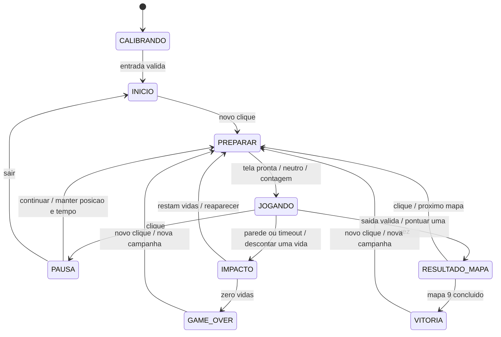
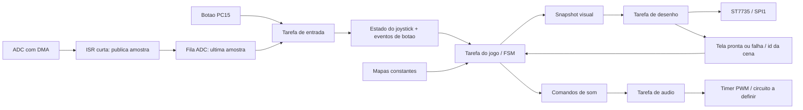

# Labirinto de Precisão — plano de implementação

Proposta v1, 27/10/2026. Nome provisório. A ideia escolhida pelo aluno é conduzir
um ponto por diferentes plantas de labirintos sem encostar nas paredes. Os
números abaixo são parâmetros iniciais de projeto, sujeitos a ajuste após jogar
na placa; não são resultados medidos nem aprovação do professor.

O aluno informou que gravou o firmware de diagnóstico e que tudo funcionou.
Isso confirma o ensaio funcional relatado de tela/joystick/botão. Áudio, testes
de duração, calibração numérica e implementação do jogo continuam pendentes.

## 1. Experiência do jogador

O joystick controla um ponto verde de **5 × 5 pixels**. O jogador começa na
entrada, observa o mapa inteiro e conduz o ponto até a saída amarela. As paredes
são sólidas e visíveis; não há obstáculos invisíveis. A campanha contém **nove
mapas fixos**, organizados em três dificuldades progressivas.

Não há inimigos ou personagens perseguindo o jogador na primeira versão. O
desafio é coordenação, leitura do caminho e controle fino. O usuário confirmou
que deseja uma **interface visual bonita e interativa**, não inteligência
artificial. Ver o [plano visual](PLANO_VISUAL.md).

### Objetivo e vitória

- Completar os mapas 1 a 9 em ordem, chegando à saída antes de acabar o tempo.
- A saída só é atingida quando a área inteira do ponto estiver dentro da zona
  de chegada, livre de paredes.
- Cada saída conclui o mapa uma única vez. Uma tela apresenta o resultado e
  o próximo mapa; o botão confirma a passagem.
- Concluir o mapa 9 mostra **VOCE VENCEU**, pontuação total e opção de nova partida.
- Reiniciar sempre começa no mapa 1, com pontos zerados e três vidas.

### Controle

- Joystick X/Y: movimento proporcional à inclinação, com diagonal normalizada
  para não andar mais rápido que nos eixos.
- Soltar o joystick: parar, sem inércia. Filtragem não deve deixar o ponto deslizar.
- Botão na tela inicial: iniciar; durante a partida: pausar.
- Na pausa, cima/baixo escolhe CONTINUAR ou SAIR; botão confirma. SAIR retorna
  ao início e encerra a campanha, sem conceder pontos pelo mapa incompleto.
- No resultado de mapa: botão avança; em GAME OVER/VITORIA: botão reinicia.
- Exigir liberação do botão antes de aceitar outro pressionamento. Um clique
  não pode pausar e retomar, nem confirmar duas telas.
- Ao iniciar/reaparecer, exigir joystick centralizado por 200 ms. Antes do
  primeiro movimento de cada mapa, mostrar contagem 3–2–1. Na retomada da pausa,
  centralizar sem reposicionar o ponto ou restaurar o tempo.

## 2. Vidas, colisão e derrota

- **Três vidas para a campanha inteira**, sem reposição automática entre mapas.
- Tocar qualquer parede ou borda externa custa **uma vida**.
- Congelar o movimento, mostrar impacto local e tocar um efeito curto. Depois
  de 600 ms, se ainda houver vida, reposicionar na entrada do mapa atual.
- A colisão não reinicia o tempo restante desse mapa. O cronômetro fica parado
  durante o efeito e a espera de centralização; volta com o movimento habilitado.
- Não permitir atravessar paredes durante reaparecimento. A nova tentativa
  começa numa região livre; não há invulnerabilidade com movimento.
- Tempo esgotado também custa uma vida. Havendo vidas, voltar à entrada e
  restaurar o limite de tempo da tentativa. O tempo ativo acumulado do mapa
  permanece registrado para calcular o bônus sem recompensar tentativas extras.
- Ao chegar a **zero vidas**, transitar imediatamente para GAME OVER, mostrar
  o motivo (PAREDE ou TEMPO), mapa alcançado e pontos dos mapas concluídos.
- Contato persistente gera uma única perda: JOGANDO sai para IMPACTO/REAPARECER.
  Não descontar uma vida por quadro.
- Falha de ADC ou display é falha técnica: suspender a partida, nunca cobrar vida.

### Ordem dos eventos no mesmo ciclo

Processar falhas técnicas primeiro. Para um ciclo de jogo, atualizar o tempo de
forma determinística; se expirou, aplicar timeout antes de testar a saída. Para
tempo ainda válido, testar a trajetória contra paredes antes de conceder chegada.
Assim, saída no mesmo ciclo que timeout não vence; colisão e saída simultâneas
também não vencem. Nunca debitar duas vidas no mesmo ciclo.

## 3. Pontuação verificável

Pontos são concedidos **somente ao concluir um mapa**, usando:

```text
D = dificuldade: 1, 2 ou 3
T = limite do mapa: 60, 50 ou 40 segundos
t = tempo ativo acumulado no mapa, em segundos, arredondado para cima
C = colisões nesse mapa, incluindo tentativas anteriores
E = esgotamentos de tempo nesse mapa

base          = 500 × D
bonus_tempo   = 5 × D × max(0, T - t)
bonus_precisao = 200 × D, somente se C = 0 e E = 0; caso contrário, zero
penalidades   = 100 × D × C + 200 × D × E
pontos_mapa   = max(0, base + bonus_tempo + bonus_precisao - penalidades)
pontos_total  = soma dos pontos dos mapas já concluídos
```

Tempo ativo inclui todas as tentativas de um mapa, mas exclui menus, pausa,
carregamento, contagem e animação de impacto. Uma nova tentativa não apaga C/E/t.
Os valores do mapa só são zerados ao avançar para um mapa diferente ou reiniciar
a campanha. Pontos totais não ficam negativos. Não pontuar movimento, tempo
parado ou entrar/sair repetidamente da saída.

Exemplos de referência para os testes:

- Fácil, 30 s, nenhuma falha: 500 + 150 + 200 = **850 pontos**.
- Médio, 30 s e uma colisão: 1000 + 200 - 200 = **1000 pontos**.
- Difícil, 55 s acumulados e um timeout: 1500 + 0 - 600 = **900 pontos**.
  Isso pressupõe completar a nova tentativa antes do seu próprio limite.
- Derrota antes da saída: **nenhum ponto do mapa incompleto**; preservar os
  pontos dos mapas anteriores para a tela final.

Usar inteiros de 32 bits e saturação explícita no zero. Calcular o bônus com o
tempo congelado na conclusão, não com o momento em que a animação termina.

## 4. As três dificuldades

**Fácil — mapas 1 a 3, 60 s por tentativa.** Corredores com largura livre mínima
de 14 pixels, 4–6 curvas no percurso principal e poucas bifurcações. Caminho
principal pretendido de 180–260 pixels. Ensina movimento, curvas e reconhecimento
da saída. Nomes: Primeira passagem, Quatro cantos, Escolha a rota.

**Médio — mapas 4 a 6, 50 s por tentativa.** Corredores com largura livre mínima
de 10 pixels, 6–8 curvas e mais caminhos sem saída. Caminho principal pretendido
de 260–380 pixels. Nomes: Corredores, Desvio, Circuito interno.

**Difícil — mapas 7 a 9, 40 s por tentativa.** Corredores com largura livre mínima
de 8 pixels, 8–12 curvas e trechos estreitos mais longos. Caminho principal
pretendido de 380–520 pixels. Nomes: Zig-zag, Precisão, Última saída.

Em todos os níveis: ponto 5 × 5, velocidade máxima inicial **24 pixels/s**, sem
inércia. Uma pequena inclinação produz movimento lento. Manter a mesma resposta
do joystick dá previsibilidade; a geometria e o tempo determinam a dificuldade.
A largura é medida no espaço livre real, não entre centros de paredes.

Os comprimentos e quantidades de curvas são metas de autoria, a verificar em
cada mapa definitivo. Não gerar labirintos aleatórios na primeira entrega:
mapas fixos permitem comparar tentativas e reproduzir os testes. A versão
mínima jogável terá três mapas, um de cada nível; a entrega planejada terá nove.

## 5. Formato dos mapas e colisão

- Tela em paisagem: **160 × 128 pixels**. HUD: y=0..15. Área do labirinto:
  x=0..159, y=16..127 (160 × 112). A lógica do mapa usa y local 0..111.
- Armazenar paredes em máscara de 1 bit por pixel, constante na Flash:
  **2240 bytes/mapa; 20160 bytes para nove mapas**, sem contar metadados.
- Desenho das paredes e colisões vêm da mesma máscara. Não manter duas versões
  independentes da planta que possam divergir.
- Metadados: id, dificuldade, limite, posição inicial, retângulo da saída,
  nome curto e máscara. Entrada e saída ficam em áreas de pelo menos 14 × 14.
- O ponto desenhado e a área de colisão são o mesmo quadrado 5 × 5. Usar posição
  em ponto fixo para movimento suave; a posição inteira usada na renderização
  também define a ocupação testada. Não desenhar um círculo com caixa invisível maior.
- Testar todas as posições inteiras atravessadas pelo movimento entre atual e
  destino, incluindo células tocadas na diagonal (varredura supercover). Em cada
  posição, verificar toda a área 5 × 5, não apenas o pixel central.
- Se qualquer pixel ocupado encontrar parede ou sair dos limites, há colisão.
  Interromper na primeira colisão; não escorregar automaticamente pela parede.
- O validador de mapas deve buscar um caminho no espaço das posições válidas
  do ponto 5 × 5; conectividade apenas para um pixel não é suficiente.
- Verificar entrada, saída, margens externas, comprimento de dados, dificuldade,
  largura mínima e existência de percurso. Guardar um percurso válido de teste
  por mapa; ele não é mostrado ao jogador.

## 6. Máquina de estados



PREPARAR recebe um motivo (novo mapa, reaparecimento ou retomada); isso determina
se deve reposicionar, reiniciar o relógio da tentativa ou apenas retomar. Não
duplicar regras de reinício entre telas. RESULTADO_MAPA do mapa 9 encaminha a
VITORIA após apresentar o resumo, sem iniciar um mapa inexistente.

FALHA é um estado global adicional: qualquer falha técnica suspende lógica e
áudio. Se o display estiver disponível, mostrar instrução curta; se não, usar
LED e diagnóstico no depurador. Não retomar automaticamente com joystick inclinado.
Recuperação exige nova validação e confirmação; caso não seja recuperável,
orientar reinício. Conservar a causa para diagnóstico.

## 7. Arquitetura FreeRTOS

Separar a lógica de jogo dos periféricos, como recomendado nas aulas de técnicas
de programação. A tarefa do jogo é a única dona de estado, vidas, tempo e pontos.
Uma única tarefa acessa o ST7735. Nenhuma tarefa de entrada desenha na tela.



### Responsabilidades, prioridades e orçamento inicial

- **Entrada:** período de 10 ms, prioridade nativa 4, pilha inicial 1024 bytes.
  Recebe amostras, verifica validade, filtra e normaliza os eixos, lê SW e aplica
  debounce. Publica estado atual e eventos. Sem espera ocupada.
- **Jogo:** período de 10 ms, prioridade 3, pilha inicial 2048 bytes. Executa a
  FSM, movimento/colisão, relógios e pontuação; publica snapshots imutáveis.
- **Áudio:** prioridade 2, pilha inicial 1024 bytes. Bloqueia aguardando evento
  ou fim de nota. Timer gera a frequência, sem alternar GPIO em laço de software.
- **Desenho:** período nominal de 33 ms, prioridade 1, pilha inicial 2048 bytes.
  Usa o snapshot mais recente, atualiza áreas alteradas e confirma a cena pronta.

Tamanhos são pontos de partida: medir margem de pilha e ajustar. Na API nativa
FreeRTOS, profundidade de pilha é em unidades de StackType_t, não bytes; converter
explicitamente para o Cortex-M4. Não passar os números de prioridade CMSIS
osPriorityNormal/AboveNormal para as novas tarefas nativas.

Usar APIs nativas nas tarefas da aplicação, aproveitando os exercícios da
disciplina. O bootstrap CMSIS existente pode ser mantido inicialmente para não
romper os handlers do port; sua tarefa de diagnóstico será substituída pela
criação das tarefas do jogo e encerrada. Revisar SysTick/PendSV/SVC antes de
qualquer migração completa. Manter TIM4 como base da HAL. Não copiar a configuração
do laboratório com sete prioridades por cima da base sem revisão.

### Comunicação e concorrência

- ADC→entrada: fila de comprimento 1 com amostra e timestamp, atualizada pela
  ISR com API FromISR; consumir apenas o valor mais recente. Manter metades DMA
  alternadas. Medir custo das interrupções; não reduzir amostragem sem rever a
  captura. Se necessário, agregar amostras antes de notificar.
- Entrada→jogo: mailbox de comprimento 1 para eixos/validade; fila de 8 eventos
  para pressionamentos e falhas. Estado contínuo pode ser sobrescrito; cliques
  não podem desaparecer por sobrescrita de estado.
- Jogo→desenho: fila de comprimento 1, com cópia de snapshot limitado (meta de
  até 128 bytes), sem ponteiros para estruturas mutáveis. Frame antigo pode cair.
- Desenho→jogo: fila de 4 confirmações/falhas com id da cena. ACK de cena antiga
  é ignorado. O relógio não começa enquanto o novo mapa ainda está sendo desenhado.
- Jogo→áudio: fila de 8 comandos. Efeito cosmético repetido pode ser descartado
  com contador de diagnóstico; comando de parada/falha tem canal de notificação
  prioritário e sempre silencia o PWM. Limpar comandos antigos ao mudar campanha.
- Fila crítica cheia é falha de integração detectável: parar a partida em vez
  de perder silenciosamente botão, confirmação ou erro. Não bloquear tarefas
  de entrada/jogo indefinidamente tentando publicar.
- Usar espera periódica absoluta (`vTaskDelayUntil`) e `pdMS_TO_TICKS`, não ticks
  soltos. Semáforo só quando há evento real; mutex apenas se houver recurso
  compartilhado. O display com dono único dispensa mutex no caminho normal.
- ISR que chama FreeRTOS respeita configLIBRARY_MAX_SYSCALL_INTERRUPT_PRIORITY.
  A base usa limite 5; não elevar prioridade de interrupção acima desse limite
  mantendo chamadas FromISR. Usar o pedido de troca de contexto quando necessário.
- Criar recursos no início e verificar retornos. Não alocar/liberar memória a
  cada quadro. Habilitar diagnósticos de pilha/heap e contadores de atraso/fila.

### Entrada e tempo

Calibrar centro com aproximadamente um segundo de joystick solto, verificando
estabilidade. Começar com zona morta de 10% da meia faixa e histerese de 2%,
ajustáveis por medição. Usar filtro leve; dentro da zona neutra, velocidade deve
ir imediatamente a zero. Aplicar debounce de 30 ms e repetição de menu deliberada,
sem repetição automática de cliques. Mostrar orientação X/Y no diagnóstico.

Sem amostra nova por 100 ms: velocidade zero e pausa técnica. Guardar timestamps
e id da partida. A lógica usa passo fixo de 10 ms, independente da renderização.
Se perder um prazo de lógica, contabilizar atraso; atraso acima de 50 ms suspende
a partida em vez de teletransportar o ponto. Tempos de jogo são calculados por
tempo monotônico e só acumulam em JOGANDO, com tratamento de wraparound.

## 8. Desenho e som

Ver [PLANO_VISUAL.md](PLANO_VISUAL.md) para inventário e [prévia](assets/proposta-visual.png).
Reaproveitar fontes bitmap existentes. Não carregar PNG/JPEG no firmware: converter
arte aprovada em máscaras/arrays const RGB565. Mapas são geometria, não fotografias.

Desenhar cenário completo somente ao trocar de mapa. Durante a partida, restaurar
o fundo nas regiões do ponto anterior/novo e atualizar HUD apenas quando mudar.
Trabalhar com faixa RGB565 de 160 × 8 pixels (2560 bytes) se necessário. Evitar
framebuffer integral e o malloc por linha usado por uma função rápida da base.
Corrigir e testar clipping, retângulos vazios e coordenadas de borda do driver.

Um quadro RGB565 inteiro tem 40960 bytes; a 12 Mbit/s, só a transmissão ideal
leva cerca de 27,3 ms, sem comandos/overhead. Isso justifica atualização parcial,
não uma promessa de desempenho. Meta de resposta visual ao comando: até 80 ms
no percentil 95, a medir; meta de lógica: 100 Hz sem atrasos recorrentes.

Sons planejados: navegação de menu, iniciar, colisão, tempo esgotado, concluir
mapa, vitória e game over. Não tocar som contínuo por movimento. Alerta de tempo
nos últimos cinco segundos, um pulso por segundo. Efeitos curtos e não bloqueantes;
game over substitui alertas anteriores. Frequências/durações finais dependem do
buzzer, ainda não adquirido. PA8/TIM1_CH1 é reserva, não ligação elétrica aprovada.

## 9. Organização prevista dos arquivos

Dentro de Core/Inc e Core/Src do projeto atual, sem criar outro projeto CubeIDE:

- `game_types.h`, `game_config.h`: contratos e parâmetros.
- `game.c/.h`: estado e regras; sem HAL/RTOS.
- `collision.c/.h`, `maps.c/.h`: ocupação, varredura e catálogo de mapas.
- `score.c/.h`: cálculo puro e auditável da pontuação.
- `input.c/.h`: calibração, filtro, zona morta e debounce; separar captura HAL
  da parte pura para testar no computador.
- `app_tasks.c/.h`: criação de tarefas/filas e integração.
- `renderer.c/.h`, `ui_assets.c/.h`: composição das telas e desenhos.
- `audio.c/.h`: sequência de efeitos e comando do timer.
- `diagnostics.c/.h`: versão, falhas e métricas, com opção de build diagnóstico.

Fora do firmware: `tests/` para regras puras; `assets/` para fontes de arte
aprovadas; `scripts/` para validar/converter mapas e compilar. Preservar créditos
do professor/bibliotecas. Não misturar código do elevador ou main dos exercícios.

## 10. Etapas e critérios de aceite

**M0 — preservar a bancada funcionando.** Registrar relato do aluno, pinagem,
commit do diagnóstico e o plano. Submeter a ideia ao professor, como exige o
enunciado. Calibração quantitativa e ensaio prolongado ainda precisam de registro.

**M1 — fundação da aplicação.** Reconciliar `.ioc` e `main.c` (HSI/PLL 96 MHz),
manter SPI1/ADC/SWD e validar a regeneração em cópia controlada. Separar tarefas,
filas e módulos; manter uma opção de diagnóstico. Aceite: mesma bancada funciona,
sem desenho concorrente, sem falha de criação e sem perda de evento de botão.

**M2 — primeiro labirinto jogável.** Um mapa fácil, ponto 5 × 5, movimento
proporcional, colisão completa e saída. Aceite: percurso válido completo,
nenhuma travessia de parede na diagonal ou ao pressionar ao máximo; ponto
imóvel no centro e reação previsível ao soltar.

**M3 — ciclo completo.** FSM, pausa, três vidas, relógios, pontuação, tela de
mapa concluído, game over e reinício pelo joystick. Aceite: exemplos de pontuação
passam; uma colisão custa uma vida; partida nova limpa todo estado anterior.

**M4 — três dificuldades.** Entregar primeiro mapas 1, 4 e 7; validar a diferença
de dificuldade e ajustar parâmetros com pessoas jogando. Depois completar os
nove mapas. Aceite: cada mapa possui percurso para o ponto inteiro, é legível
e pode ser vencido dentro do limite. Anotar tempos e dificuldades reais, não supor.

**M5 — acabamento visual e áudio.** Aplicar ícones, telas e efeitos aprovados;
selecionar buzzer/driver, montar e medir. Aceite: som funciona sem bloquear entrada
ou desenho, textos não cortam, nada decorativo esconde corredor/saída.
Produção de arte e escolha do buzzer podem ocorrer em paralelo a M2–M4.

**M6 — validação e entrega.** Executar testes de regras/integração e sessão
contínua de 30 minutos na placa. Medir latência, pilhas, memória e falhas. Concluir
relatório com esquema real, fotos, decisões e resultados. Aceite: build reproduzível
em outra máquina, nove mapas acessíveis, três dificuldades, áudio, reinício e
evidências; nenhum teste pendente descrito como aprovado.

## 11. Plano de testes

Testes puros, sem placa: colisão em cada lado/canto, diagonal, corredor estreito,
limite externo, deslocamento maior que um pixel, spawn/saída inválidos; pontuação
nos exemplos e no zero, não duplicar prêmio; última vida, timeout simultâneo à
saída, pausa/congelamento, transições e reinício; calibração, ruído no centro,
debounce e botão segurado; integridade e alcançabilidade dos nove mapas.

Integração RTOS: segurar joystick numa parede sem perder várias vidas, clicar
rápido em transições, forçar fila cheia, atrasar renderização, invalidar ADC,
simular erro SPI e confirmar silêncio do áudio na falha. Checar ACK de cena
antiga, snapshot atrasado e sequência de comandos após reinício. Medir duração
de tarefas/ISR; não imprimir dentro de ISR nem adicionar USB CDC sem planejamento.

Bancada: imagem completa e cores, centro/extremos/orientação do joystick,
leitura confortável dos textos, resposta ao soltar, som, alimentação estável,
vitória/derrota por ambos os motivos e campanha completa. Registrar firmware,
condições e resultados. Não executar desligamentos de periféricos com alimentação
ligada; falhas podem ser injetadas no software.

## 12. Entrega e relação com a disciplina

O relatório deve conter: requisito e aprovação da ideia; regras e exemplos de
pontuação; esquema e fotos da montagem; mapa de tarefas/prioridades/filas;
FSM; formato dos mapas e colisão; projeto visual; medições/testes; instruções
de reprodução; limitações e contribuições do aluno/professor/bibliotecas.

Base de estudo utilizada:

- [Enunciado](../referencias/Projeto_uC_II_2026_02.pdf): ARM + RTOS, display,
  joystick, sons, telas inicial/final, reinício pelo joystick e três dificuldades.
- `SLIDES/uCII_01_Tecnicas_Programacao.pdf`, páginas 24 e 29 do PDF local: projetar
  FSM, separar detalhes de hardware e verificar comportamentos indevidos.
- `SLIDES/uCII_04_RTOS.pdf`, páginas 18, 22, 31–37: tarefas, preempção, semáforos,
  inversão de prioridade, deadlock e filas. Slides disponíveis no workspace MIC2.
- [Exercícios do laboratório](../../ex_Barry_USB_STM32F411CE/Core/Src/lab_examples.c):
  periodicidade (5/6), filas/mutex (10/11), sinalização de interrupções (12–14).
- [FreeRTOS: periodicidade](https://freertos.org/Documentation/02-Kernel/04-API-references/02-Task-control/02-vTaskDelayUntil)
  e [manual da API](https://en.freertos.org/media/2018/FreeRTOS_Reference_Manual_V10.0.0.pdf):
  conferir contratos de filas de comprimento 1, chamadas FromISR e unidades de pilha.

Fora da primeira entrega: geração aleatória, inimigos/IA, física com inércia,
motor, rede, microSD, ranking persistente em Flash e novos modos de jogo. O
recorde da sessão pode ficar em RAM; persistência exigiria projeto próprio de
gravação/desgaste e não é necessária para cumprir o enunciado.
