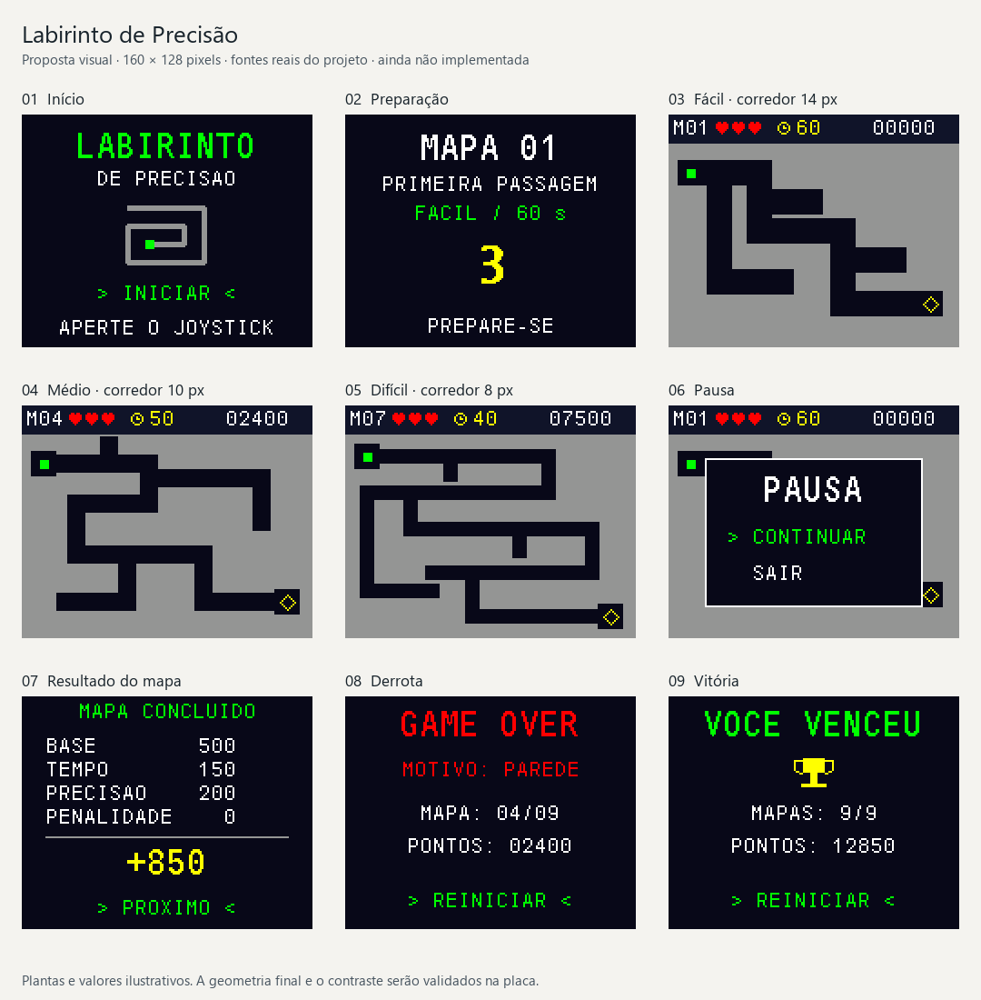

# Interface e assets — Labirinto de Precisão

Proposta visual v1, 27/10/2026. O usuário confirmou que pretende uma interface
bonita e interativa. Este documento planeja a arte; não descreve telas já
executadas no STM32. A [prévia abaixo](assets/proposta-visual.png) é desenhada em
160 × 128 pixels e ampliada sem suavização para inspecionar legibilidade.

## O que já existe e o que podemos reaproveitar

- `Core/Inc/fonts.h` e `Core/Src/fonts.c`: fontes bitmap **7×10, 11×18 e 16×26**.
  Usar 7×10 no HUD/menus, 11×18 nos títulos e 16×26 na contagem 3–2–1.
  Não precisamos desenhar uma fonte nova na primeira versão.
- `figuras.c/.h`: título Campo Minado de 130×11 e soldado de 7×7. Preservar como
  material do professor; não usar na identidade visual do labirinto.
- `st7735.c/.h`: texto, figuras monocromáticas, imagens RGB565, pixels e
  retângulos. São os blocos de desenho, não uma interface pronta.
- Não foram encontrados arquivos PNG/JPEG/SVG/TTF/OTF dentro da base importada.
  Não há pacote existente de corações, menus, labirintos ou personagens desse jogo.

## Direção visual

Tema: painel eletrônico de precisão. Fundo escuro, planta clara, ponto verde e
saída amarela. Poucas cores, contornos definidos e nenhuma textura no corredor.
Criatividade deve vir dos mapas, transições e identidade do menu, sem dificultar
o reconhecimento do espaço livre.

Paleta proposta em RGB565: fundo `0x0843`, painel `0x10A5`, parede `0x94B2`, texto
`0xFFFF`, ponto/seleção `0x07E0`, saída/atenção `0xFFE0`, erro `0xF800`.
Conferir RGB/BGR e contraste na tela real antes de aprovar a paleta.
Cor não será o único identificador: ponto é quadrado, saída tem losango/seta,
vidas têm forma de coração e seleção tem marcador lateral.

Não usar fotos, fundos complexos, sombra, transparência parcial ou fontes
antialiasadas na versão inicial. Esses efeitos ocupam pixels e dificultam o
desenho parcial. Texto do firmware será inicialmente ASCII: `PRECISAO`,
`PROXIMO`, `VOCE VENCEU`. Acentos só depois de adicionar e testar glifos.

## Tela de jogo: organização exata

- HUD de 160×16 pixels, sem invadir a planta. Campo: `M01`, três corações,
  relógio/segundos e pontuação total em cinco dígitos.
- Posições iniciais: mapa em x=2; corações em x=26/35/44; relógio em x=60;
  segundos em x=70; pontos em x=112. Texto 7×10, y=3; tudo cabe em 160 pixels.
- Labirinto em x=0..159 e y=16..127. Sem barra inferior ou legenda que reduza
  o caminho. Explicações aparecem antes de jogar.
- Ponto 5×5 de cor sólida. Não aumentar o desenho com brilho que pareça colisão.
- Saída dentro de área livre de 14×14, com símbolo de 7×7 e contraste fixo.
- Mostrar a dificuldade e o nome do mapa na tela PREPARAR; o HUD durante a
  partida prioriza informação imediata.
- Cronômetro mostra segundos restantes arredondados para cima. Alterar HUD
  apenas quando vida, segundo, mapa ou pontuação mudar.

## Telas e interação

1. **Início:** logotipo textual, símbolo simples do labirinto, ação INICIAR e
   instrução `APERTE O JOYSTICK`. Um pequeno ponto pode percorrer a marca apenas
   nesta tela. Identificação curta da versão em uma tela de informações/diagnóstico.
2. **Preparação:** número, nome e dificuldade do mapa; `CENTRALIZE` quando
   necessário; contagem 3–2–1 após confirmação da tela pronta.
3. **Partida:** mapa, ponto, saída e HUD. Nenhuma animação decorativa de fundo.
4. **Pausa:** janela opaca com PAUSA, CONTINUAR e SAIR; joystick seleciona,
   botão confirma. Manter mapa ao fundo, sem executar movimento ou cronômetro.
5. **Impacto/reaparecimento:** marcador local de erro, `-1 VIDA` em sobreposição
   breve e retorno à entrada. Não piscar a tela inteira.
6. **Mapa concluído:** sinal de confirmação e valores de base, bônus e penalidade;
   exibir total ganho. Botão PROXIMO. O desenho precisa caber nas fontes existentes.
7. **Game over:** motivo PAREDE/TEMPO, mapa, pontuação e REINICIAR. Não repetir
   o comando de reinício até soltar e apertar novamente o botão.
8. **Vitória:** troféu geométrico, `VOCE VENCEU`, mapas 9/9 e pontuação final;
   animação de celebração breve, seguida de tela estática.
9. **Calibração/falha:** instruções de uma ou duas linhas e símbolos claros.
   A interface informa o problema; falha de display usa LED/depuração.

As nove miniaturas da prévia mostram início, preparação, três plantas de
dificuldade diferente, pausa, resultado, game over e vitória. Números, plantas
e pontuações são exemplos de composição, não capturas da placa nem nove mapas
definitivos. No resultado ilustrado, base 500 + tempo 150 + precisão 200 = 850.

## Inventário de produção

### Essenciais para a primeira versão jogável

- **Marca do jogo:** composição textual, aproximadamente 110×42, usando fontes
  existentes; símbolo de labirinto de 24×24. Criar uma identidade própria.
- **Ponto do jogador:** quadrado 5×5, desenhado por primitiva. Não precisa de
  personagem detalhado; o jogador deve entender exatamente a área que colide.
- **Entrada e saída:** marcador inicial 7×7 e saída em losango/seta 7×7.
  Entrada é parte do fundo; não deve esconder a posição do ponto.
- **Coração cheio/vazio:** duas máscaras de 7×7, três instâncias no HUD.
- **Relógio:** máscara 7×7. Os dígitos vêm da fonte 7×10.
- **Seta de seleção:** máscara 5×7; marcador de pausa 7×7.
- **Confirmação e erro:** máscaras 9×9 para transições e avisos.
- **Plantas:** primeiro uma fácil, uma média e uma difícil; depois nove no total.
  Exportar a geometria para a máscara de colisão, não desenhar PNG de fundo
  separado. A máscara deve ser a fonte única de paredes no renderizador.
- **Troféu:** máscara de até 16×16 para a tela final.

### Acabamento após validar as regras

- **Mascote do menu, opcional:** pequeno ponto/robô de 16×16, três poses
  (neutro, feliz, erro). Apenas no menu e nos resultados; não substituir o ponto
  5×5 durante a partida. Cortar este item se atrapalhar prazo ou legibilidade.
- **Impacto local:** três quadros de até 9×9, sem alterar a área de colisão.
- **Confete de vitória:** poucos quadrados desenhados por primitiva, com duração
  máxima de um segundo; não criar uma imagem de fundo enorme.
- **Guia de joystick:** até 16×16 para a primeira tela de instruções.

Não é necessário produzir animação de caminhada, nave, monstros, cenário 3D,
retratos ou grandes ilustrações. O foco visual é a planta e a precisão do ponto.

## Formatos, memória e autoria

Guardar fontes de arte em `assets/` quando aprovadas; converter ícones para
máscaras de 1 bit e usar cor definida pelo renderizador. Uma máscara 7×7 cabe em
7 bytes se cada linha for armazenada em um byte. Um sprite RGB565 de 16×16 ocupa
512 bytes por quadro; reservar esse formato para arte que realmente precise
de múltiplas cores.

Fontes bitmap já disponíveis não precisam de novos arquivos de fonte no produto.
Preservar créditos/licenças existentes. Desenhar ícones novos em grade, com
coordenadas inteiras e sem suavização. Exportar PNG apenas para documentação;
o microcontrolador recebe arrays constantes e primitivas. Não introduzir
decodificador de imagem, cartão microSD ou alocação dinâmica por quadro.

O [gerador da prévia](assets/gerar_proposta.py) reaproveita os bits das fontes do
professor para mostrar o tamanho real dos textos. Usa Pillow somente no computador;
não adiciona dependência ao firmware. As máscaras e plantas da prévia são estudos
visuais, ainda não convertidos em assets finais de produção.

## Critérios de aprovação visual

- Conferir cada tela em tamanho real, não apenas ampliada no computador.
- Textos inteiros, sem cortar ou sobrepor elementos; mensagens mais longas
  devem quebrar linha manualmente ou ser abreviadas.
- Paredes, ponto e saída identificáveis sem depender só de cor.
- O pixel desenhado como parede deve ter a mesma ocupação na colisão.
- Testar extremos do HUD: mapa 09, zero/três vidas, 00/60 segundos e 99999 pontos.
- Sem rastro ao mover o ponto, sem restauração que apague paredes ou saída.
- Menus respondem a uma ação de cada vez e indicam a opção selecionada.
- Animações nunca bloqueiam leitura do joystick, tempo do jogo ou áudio.
- Validar contraste, orientação, offsets e ordem de cores no módulo físico.

Ordem de execução: layout e fontes existentes → ponto/parede/saída → HUD e
ícones essenciais → menus/resultados → efeitos locais → mascote opcional.
