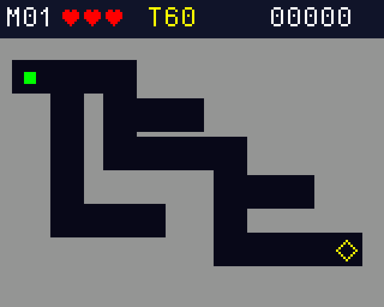

# Primeiro mapa jogável — M01 v0.1

Implementado em 27/10/2026. Esta é a versão para testar **um mapa fácil** na
placa, com a mesma pinagem do diagnóstico já validado pelo aluno. Não é a
campanha de nove mapas. O código foi compilado e testado no computador;
esta nova versão ainda precisa do ensaio físico descrito abaixo.



Imagem gerada pelo código de desenho com painel simulado; não é fotografia da placa.

## O que está disponível

- Calibração automática do centro, tela inicial identificada como **M01 v0.1**.
- Mapa Primeira passagem, ponto verde 5×5 e saída em losango amarelo.
- Joystick proporcional, zona morta, filtro e diagonal com velocidade limitada.
- Colisão com o ponto inteiro, incluindo as posições atravessadas entre quadros.
- Três vidas, 60 segundos por tentativa e pontuação do nível fácil.
- Pausa com CONTINUAR/SAIR, contagem de preparação, game over e reinício.
- Ao alcançar a saída, tela **CONCLUIDO! / PRIMEIRO MAPA OK**. Reiniciar joga
  novamente esse mapa; não há passagem para mapas ainda não implementados.
- Diagnóstico de bancada preservado como opção de compilação.

Som não foi ativado: o buzzer e seu circuito ainda precisam ser escolhidos.
PA8 continua reservado e não é acionado por esta versão.

## Atualizar, compilar e gravar na outra máquina

Na pasta do clone, atualizar com `git pull --ff-only`. Se houver alterações
locais, preservá-las antes de resolver a atualização; não usar reset forçado.
No CubeIDE, atualizar o projeto com Refresh, executar **Project → Clean** e
**Build Project**. A opção padrão é o jogo (`APP_DIAGNOSTIC=0`).

Importar/abrir somente `projeto-jogo/Game_Start2_STM32F411CE`. Em Run/Debug
Configurations, conferir que o executável é o `.elf` da pasta Debug desse
projeto, não um arquivo antigo ou o projeto dos exercícios. Gravar com ST-Link.
Se o depurador parar no início, usar Resume para iniciar a execução.

Não regenerar pelo `.ioc` nesta entrega. O clock HSI/PLL de 96 MHz já testado
foi preservado no `main.c`; reconciliar/regenerar o `.ioc` herdado continua
pendente. As fontes estão prontas para compilar diretamente no projeto existente.

Pela linha de comando, dentro de `projeto-jogo`:

```sh
python3 scripts/build_base.py
```

Usar `--cc` com o caminho do compilador ARM, se não estiver no PATH. Os arquivos
novos são:

- `build/mapa01/labirinto-mapa01.elf`
- `build/mapa01/labirinto-mapa01.hex`
- `build/mapa01/labirinto-mapa01.bin`

O GitHub Actions compila o código e disponibiliza o artefato
**mic2-labirinto-mapa01**. O `.hex` pode ser gravado pelo CubeProgrammer com
verificação; ele já contém os endereços. Para o `.bin`, o endereço é 0x08000000.
Binários antigos chamados `base-professor.*` não correspondem a esta entrega.

Para voltar ao diagnóstico sem trocar os fios:

```sh
python3 scripts/build_base.py --diagnostic
```

O resultado fica em `build/diagnostico/diagnostico-spi1.*`. No CubeIDE, mudar
`APP_DIAGNOSTIC` para 1 em `Core/Inc/game_config.h`, limpar e recompilar. Voltar
a zero para jogar. O diagnóstico original também está preservado no histórico
do commit `4382347`.

## Ligações mantidas

Display: VCC/LED em 3V3, GND em G, CS B12, RESET B13, A0/DC B14, SDA A7 e SCK A5.
Joystick: VRY A0, VRX A1, SW C15, alimentação em 3V3 e GND comum. Ver
[HARDWARE.md](HARDWARE.md). MicroSD e buzzer continuam desconectados.

## Como testar

1. Ao ligar/resetar, deixar o joystick solto por aproximadamente um segundo.
   O centro deve estar estável e aproximadamente na metade da faixa. Enquanto
   ele estiver fora dessa condição, a tela solicita centralizar; isso não é
   necessariamente um travamento.
2. Conferir **LABIRINTO / DE PRECISAO / M01 v0.1** e pressionar o joystick.
3. Soltar o botão e centralizar o joystick. Aguardar 3–2–1. O cronômetro só
   começa depois que o display confirma o desenho do mapa.
4. Mover pouco o joystick para andar devagar. O ponto deve parar ao centralizar.
   O mapa tem ramificações sem saída; observar o caminho até o losango amarelo.
5. Encostar numa parede: deve perder exatamente uma vida, mostrar o impacto
   e voltar à entrada. O tempo restante é preservado durante essa colisão.
6. Pressionar para pausar. Cima/baixo alterna CONTINUAR/SAIR; botão confirma.
   Ao continuar, centralizar: posição, pontos e tempo devem ser preservados.
7. Deixar o tempo terminar: perde uma vida. Se restarem vidas, a nova tentativa
   recebe 60 s, mas o tempo ativo acumulado e as penalidades não são apagados.
8. Com zero vidas, conferir GAME OVER. Soltar e pressionar para reiniciar com
   três vidas, 60 s e zero pontos.
9. Chegar ao losango com o ponto inteiro: conferir CONCLUIDO e a pontuação.
   Um novo clique reinicia o mesmo mapa. Não somar pontos mantendo o botão
   pressionado ou permanecendo na saída.

Se X/Y estiverem invertidos em relação à montagem, usar `GAME_INVERT_X` ou
`GAME_INVERT_Y` em `game_config.h` (0 normal, 1 invertido), recompilar e registrar
a orientação escolhida. A pinagem de X/Y não mudou. Não trocar fios aleatoriamente.

## Implementação e decisões deste marco

O bootstrap CMSIS é mantido. Ele cria três tarefas nativas e depois se encerra:
entrada (10 ms, prioridade 4), jogo (10 ms, prioridade 3) e desenho (33 ms,
prioridade 1). Uma tarefa controla o display; nenhuma ISR desenha.

ADC/DMA usa 64 meias-palavras, em duas metades. Cada callback calcula a média
de 16 pares e publica o último valor em uma fila de comprimento 1, com API
FromISR e prioridade NVIC 5. Isso evita uma interrupção para cada par do exemplo
inicial. Entrada publica eixos por mailbox e cliques por fila separada.

O jogo publica um snapshot; o desenho confirma o id da cena. Preparação e
primeiro movimento esperam essa confirmação. Filas críticas cheias, amostra
antiga (>100 ms), atraso da lógica (>50 ms enquanto joga) ou falha SPI suspendem
a partida. Falha técnica não desconta vida. Mensagem/LED rápido indicam falha;
rever a conexão e resetar, pois recuperação automática não faz parte deste marco.

Há filtro leve, zona morta de 10%, parada imediata no neutro e debounce de 30 ms.
A histerese adicional de 2% proposta no plano não foi introduzida: validar
primeiro o centro real e acrescentá-la se houver oscilação na bancada.

A máscara de paredes tem 2240 bytes na Flash. Desenho e colisão consultam os
mesmos bits. O ponto usa posição em milésimos de pixel e varredura supercover.
O renderizador usa uma faixa de 2560 bytes e restaura regiões alteradas, sem
framebuffer integral. O ST7735 recebeu timeout limitado, indicação de erro,
correção da janela de pixel, verificação de limites e preenchimento sem malloc.

O HUD usa `T` para tempo nesta primeira versão. Mascote, animações elaboradas,
oito mapas adicionais, três dificuldades e áudio permanecem no plano.

## Testes reproduzíveis

Com Python 3 e GCC/Clang no computador (Linux/WSL):

```sh
python3 scripts/generate_map.py --check
python3 scripts/test_host.py --sanitize
```

- 93 verificações da lógica: mapa alcançável para ponto 5×5, percurso completo,
  varredura/diagonal, vidas, pontuação, timeout, pausa, reinício e entrada.
- Renderizador real com painel simulado: nove estados, limites dos textos,
  RGB565 e igualdade entre quadro completo e atualização parcial.
- Driver ST7735 real com SPI simulado: pixel na borda, clipping, dimensões zero,
  ordem dos bytes e falha de transmissão limitada.
- AddressSanitizer e UndefinedBehaviorSanitizer nos testes do computador.
- Compilação ARM do jogo e da opção de diagnóstico. O teste do computador não
  simula escalonamento/tempos reais nem substitui o teste de montagem.

Os arquivos PPM produzidos em `build/host` são quadros do código de desenho
executado com interface simulada, não fotografias da placa.

## Resultado da compilação local

GNU Tools for STM32 14.3.rel1 (GCC 14.3.1), configuração sem otimização (`-O0`),
48 objetos ligados e nenhum aviso de `-Wall`:

- Jogo: text 51480, data 120 e bss 24264 bytes.
- Diagnóstico opcional: text 32228, data 104 e bss 21616 bytes.

BSS inclui o heap reservado do FreeRTOS; não representa medição de uso máximo
durante uma partida. A margem real de pilha/heap será medida na placa.

## Registrar resultados da placa

Status: **aguardando o primeiro ensaio de M01 v0.1**. O relato anterior do aluno
se refere ao diagnóstico, não valida automaticamente o jogo.

- Commit gravado e identificação M01 v0.1: ______.
- Calibração terminou com joystick solto: ______.
- X/Y e resposta ao centralizar: ______.
- Uma colisão = uma vida, incluindo contato prolongado: ______.
- Pausa e retomada preservam posição/tempo: ______.
- Timeout, game over e reinício: ______.
- Saída e pontos apresentados: ______.
- Cinco minutos jogando/reiniciando sem falhas: ______.
- Foto/vídeo e observações sobre largura/velocidade: ______.

No depurador, `game_input_stack_free`, `game_logic_stack_free` e
`game_render_stack_free` indicam margem de pilha em palavras; `game_min_free_heap`
indica bytes e `game_late_ticks` conta ciclos com atraso. Medir antes de reduzir
pilhas ou aumentar carga. A próxima etapa será ajustar jogabilidade e acrescentar
os mapas médio/difícil e áudio, conforme [PLANO_LABIRINTO.md](PLANO_LABIRINTO.md).
