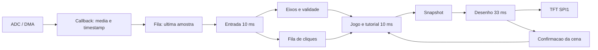
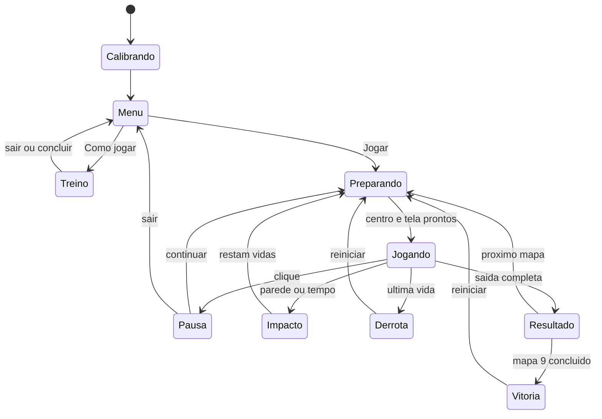
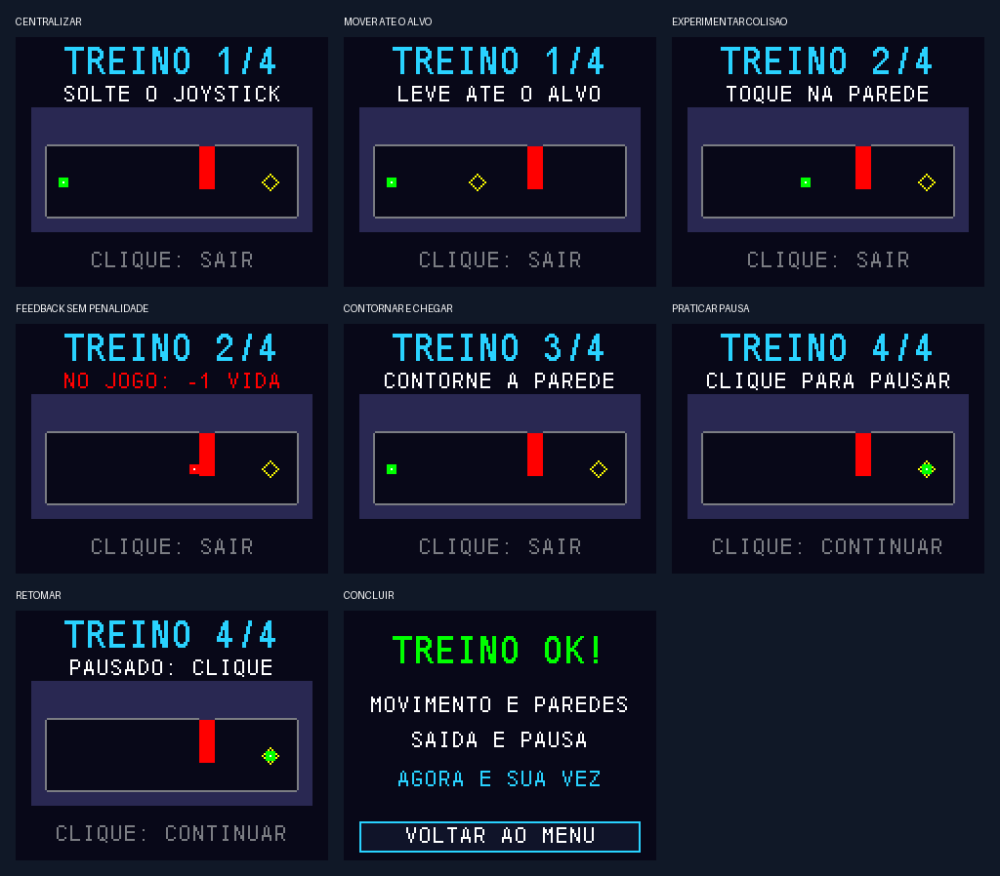

# Relatório técnico — Labirinto de Precisão

**Versão de trabalho: TUTORIAL v0.4 — 03/11/2026.**

Disciplina: Microcontroladores II — IFSC. Autor e professor: preencher conforme
a identificação acadêmica da entrega. Este relatório descreve o que está
implementado e distingue ensaios automatizados, relato do aluno e medições
pendentes. Não é uma declaração de aprovação docente ou de validação final.

## Resumo

Foi desenvolvido um jogo de precisão para STM32F411, display TFT SPI 160×128 e
joystick analógico com botão. O jogador conduz um ponto por nove labirintos,
organizados em três dificuldades, sem tocar nas paredes. O firmware utiliza
FreeRTOS para separar aquisição de entrada, regras e atualização gráfica.
A comunicação usa filas e snapshots; uma única tarefa acessa o display.
A aplicação inclui vidas, tempo, pontuação acumulada, pausa, reinício, vitória
final e um tutorial interativo em uma arena de treinamento sem penalidades.
O áudio permanece pendente da escolha e montagem do buzzer.

## 1. Objetivo e requisitos

O trabalho parte do enunciado [Projeto_uC_II_2026_02](../referencias/Projeto_uC_II_2026_02.pdf)
e da base `Game_Start2_STM32F411CE` fornecidos pelo professor. O objetivo é
aplicar programação estruturada por estados, interrupções, periféricos e RTOS
em uma aplicação interativa. A ideia do elevador foi transferida para MAQ e
não integra este firmware.

Requisitos implementados em software: alvo ARM, RTOS, display, joystick,
título, derrota, reinício pelo botão e três níveis de dificuldade.
A aprovação da ideia e o requisito de sons ainda precisam ser concluídos ou
registrados. Os nove mapas e o tutorial não substituem a validação física.

## 2. Hardware e alimentação

Alvo do projeto: STM32F411CEU6. A marcação exata do microcontrolador físico deve
ser registrada por fotografia legível; o alvo de compilação não constitui
identificação visual da placa. O módulo fotografado possui inscrição
**1.8 TFT SPI 128×160 V1.1**, utilizado em paisagem com driver ST7735. O
funcionamento foi relatado pelo aluno, mas a inscrição do controlador interno
não foi confirmada visualmente.

Ligações mantidas:

- TFT: VCC/LED em 3V3, GND em G, CS em PB12, RESET em PB13, DC/A0 em PB14,
  SDA/MOSI em PA7 e SCK em PA5.
- Joystick: VRY em PA0, VRX em PA1, SW em PC15 com pull-up; alimentação em
  3V3 e GND comum, inclusive no terminal do módulo rotulado +5V.
- Depuração: SWD nos pinos PA13/PA14; não confundir com SCK do display.
- PA8 reservado para áudio futuro; microSD sem utilização.

O esquema detalhado e cuidados de montagem estão em [HARDWARE.md](HARDWARE.md).
Há uma [fotografia dos componentes fornecida pelo aluno](assets/componentes-aluno.png),
que registra a preparação da montagem, sem mostrar o firmware em execução.
Inserir na entrega final fotografia da montagem real, identificação dos
componentes e circuito do buzzer. Não foram produzidas imagens que simulem
uma fotografia de ensaio físico.

## 3. Configuração do microcontrolador

O firmware usa HSI de 16 MHz, PLLM=16, PLLN=192, PLLP=2 e PLLQ=4. O sistema e
AHB operam a 96 MHz; APB1 a 48 MHz e APB2 a 96 MHz. A divisão da SPI1 por 8
resulta em clock nominal de 12 MHz. O ADC usa divisão por 4 e dois canais:
PA0/canal 0/rank 1 para Y, PA1/canal 1/rank 2 para X, com 480 ciclos de amostragem.
Esses números são configurações dos fontes, não medições com osciloscópio.

O DMA2 Stream0/canal 0 usa modo circular e alinhamento half-word. O buffer
contém 64 amostras alternadas; cada callback calcula a média de 16 pares de
uma metade concluída. A interrupção publica a amostra com timestamp por API
FromISR, sem desenho ou espera. A prioridade NVIC 5 respeita o limite 5 do
FreeRTOS. TIM4 fornece o tick da HAL; SysTick/PendSV/SVC permanecem sob o port
FreeRTOS/CMSIS existente.

O `.ioc` foi alinhado ao HSI, liberando PH0/PH1, explicitando o ADC e os
parâmetros de diagnóstico do RTOS. Os hooks de erro ficam em regiões USER CODE
de `freertos.c`. O procedimento e a ressalva de compatibilidade do gerador
estão em [REGENERACAO.md](REGENERACAO.md).

## 4. Arquitetura FreeRTOS

A tarefa bootstrap CMSIS cria recursos e tarefas, inicia ADC/DMA e se encerra.
São mantidas três tarefas nativas:

- **Entrada:** período nominal de 10 ms, prioridade 4, pilha de 256 palavras
  (1024 bytes). Faz calibração, filtro, zona morta e debounce.
- **Jogo:** período nominal de 10 ms, prioridade 3, pilha de 512 palavras
  (2048 bytes). É a única responsável por estado, movimento, vidas e pontos.
- **Desenho:** período nominal de 33 ms, prioridade 1, pilha de 512 palavras
  (2048 bytes). É a única proprietária do ST7735.

O heap reservado do kernel é de 15360 bytes. Os períodos e tamanhos acima são
configurações iniciais; ainda devem ser confrontados com medições na placa.



Eixos/amostras/snapshots usam filas de comprimento 1 para representar o estado
mais recente; cliques usam fila de oito eventos. A confirmação do desenho
impede começar uma fase antes que a tela esteja pronta. Mutex não é necessário
para o display porque somente uma tarefa o acessa. Esse desenho evita usar
sincronização apenas para cumprir uma lista de APIs sem recurso compartilhado.

## 5. Máquina de estados e regras

A campanha alterna calibração, título, preparação, jogo, pausa, impacto,
resultado, vitória, derrota e falha técnica. COMO JOGAR abre o estado de treino,
com etapas internas; ele não concede pontos nem desconta vidas.



São três vidas para toda a campanha, sem reposição entre fases. Colisão perde
uma vida e retorna à entrada preservando o tempo restante. Timeout perde uma
vida e restaura o limite da tentativa, mas mantém tempo ativo e penalidades
acumulados para pontuação. Pausa e preparação não contam como tempo ativo.
Falhas de ADC, SPI, fila ou atraso suspendem a aplicação sem descontar vidas.

## 6. Mapas, movimento e pontuação

Mapas 1–3 têm corredores de 14 pixels e 60 s; 4–6, 10 pixels e 50 s;
7–9, 8 pixels e 40 s. O ponto mantém 5×5 pixels e velocidade máxima de
24 pixels/s, proporcional à inclinação e normalizada na diagonal.
A calibração usa aproximadamente um segundo de amostras estáveis, filtro leve,
zona morta de 10% e debounce de 30 ms. Não há inércia após centralizar.

As plantas vêm de JSON e são convertidas em máscaras de um bit por pixel:
2240 bytes por mapa, totalizando 20160 bytes para a campanha. A arena do
tutorial ocupa outros 2240 bytes. As máscaras e metadados ficam constantes na
Flash. Desenho e colisão consultam os mesmos dados; não existem paredes visuais
separadas das paredes lógicas. A varredura inclui as posições atravessadas,
evita atravessar paredes e considera o ponto inteiro, inclusive na saída.

Pontuação por mapa concluído, com dificuldade D=1/2/3, limite T=60/50/40 e
tempo ativo acumulado t arredondado para cima:

```text
max(0, 500D + 5D*max(0,T-t) + bonus_limpo - 100D*colisoes - 200D*timeouts)
bonus_limpo = 200D somente quando nao houve colisao nem timeout
```

A pontuação total soma somente mapas concluídos. Reiniciar zera a campanha;
repetir uma tentativa não apaga penalidades. Exemplos verificados: fácil em
30 s sem erro = 850; médio em 30 s com uma colisão = 1000; difícil com 55 s
acumulados e um timeout = 900. O catálogo e percursos estão em [CAMPANHA.md](CAMPANHA.md).

## 7. Interface e tutorial interativo

A interface usa fontes bitmap 7×10, 11×18 e 16×26 do projeto base. Menu e pausa
possuem seleção destacada; nove segmentos mostram progresso; cor e texto
identificam dificuldade. O HUD mostra vidas, relógio e pontos, com alerta
vermelho nos últimos cinco segundos. O display restaura somente regiões
alteradas durante movimento, utilizando buffer de 160×8 pixels (2560 bytes).
Não há framebuffer completo nem alocação a cada quadro.

O tutorial utiliza o mesmo movimento, normalização e teste de colisão da
campanha, com arena própria. O usuário centraliza o joystick, conduz o ponto
até um alvo, experimenta uma colisão com feedback, contorna um obstáculo até
a saída e pratica pausar/retomar pelo botão. Pode sair durante os exercícios.
O treino exige ações do jogador; não é apenas uma sequência de textos.



Esta imagem e as [prévias da interface](assets/interface-renderizada.png) são
quadros de testes no computador, não fotografias da placa.

## 8. Verificações e evidências disponíveis

- Testes portáveis com GCC, warnings tratados como erro e sanitizadores
  AddressSanitizer/UndefinedBehaviorSanitizer.
- Busca independente de caminhos nas máscaras compiladas e percurso completo
  pelos nove mapas através da máquina de estados real.
- Verificações de vidas, tempo, score, pausa, derrota posterior, vitória,
  reinício, calibração, debounce e falhas técnicas.
- Tutorial percorrido até a conclusão, incluindo erro e repetição sem penalidade.
- Desenho testado em painel simulado: limites de texto, menus, contagem, alerta,
  paredes, saída e igualdade entre atualização parcial e quadro completo.
- Driver ST7735 testado com SPI simulado: bordas, clipping, bytes e timeout.
- Verificador de coerência entre `.ioc`, inicialização C, ADC, RTOS e hooks.
- Compilações ARM do jogo, diagnóstico e cópia regenerada, conforme registro
  de [REGENERACAO.md](REGENERACAO.md).

**Relato físico recebido em 03/11/2026:** ao ser perguntado sobre a conclusão dos
nove mapas e problemas de controle, tela, pausa ou transição, o aluno confirmou:
“sim consegui, sem problemas ate entao”. Registra-se a campanha da versão
anterior ao tutorial como concluída na placa, sem problemas relatados.
O commit exato e a duração da sessão não foram informados. Esse relato
funcional não constitui medição individual de latência, pilha ou estabilidade.
O tutorial v0.4 e a cópia regenerada ainda precisam de reteste físico.

## 9. Medições a preencher na bancada

- Versão/commit gravado, identificação da placa e alimentação: pendente.
- Orientação e centro/extremos do joystick: pendente de valores registrados.
- Tempo e erros por mapa; observações de dificuldade: pendente.
- Latência entre joystick e imagem e duração das tarefas/ISR: pendente.
- Margens de pilha: observar `game_input_stack_free`, `game_logic_stack_free`
  e `game_render_stack_free`, em palavras de 32 bits.
- Heap mínimo: `game_min_free_heap`, em bytes; atrasos: `game_late_ticks`.
- Sessão contínua de 30 minutos, fotos e vídeo: pendente de evidências.
- Resultado do tutorial na placa e áudio: pendente.

Os tamanhos estáticos de compilação constam em [CAMPANHA.md](CAMPANHA.md).
BSS inclui heap reservado e não equivale a memória máxima usada em execução.

## 10. Limitações e conclusão parcial

O software implementa a campanha de nove mapas e um treino interativo,
com arquitetura concorrente, regras testáveis e compilação reproduzível.
Ainda faltam áudio, medições e registro sistemático de bancada, identificação
física completa e aprovação docente. Os testes de computador não simulam os
tempos reais do escalonador ou a integridade elétrica da montagem.
A conclusão final deve ser atualizada após essas atividades, sem substituir
resultados medidos por metas ou estimativas.

## 11. Reprodução e referências

- [Guia de compilação e bancada](CAMPANHA.md).
- [Configuração e regeneração](REGENERACAO.md).
- [Plano e relação com as aulas](PLANO_LABIRINTO.md): máquinas de estados,
  periodicidade, prioridades, filas, interrupções e propriedade dos recursos.
- [Origem e licenças dos materiais](../referencias/ORIGEM.md). HAL, CMSIS,
  FreeRTOS, fontes e base do professor mantêm seus créditos; não se atribui
  sua autoria ao aluno.
- STMicroelectronics, [UM1718 — STM32CubeMX](https://www.st.com/resource/en/user_manual/um1718-stm32cubemx-for-stm32-configuration-and-initialization-c-code-generation-stmicroelectronics.pdf),
  revisão 50, cópia local consultada, páginas 49–51: comandos de geração.
- STMicroelectronics, [STM32CubeF4 v1.28.3](https://github.com/STMicroelectronics/STM32CubeF4/tree/v1.28.3):
  referência de bibliotecas para o ensaio de regeneração.
