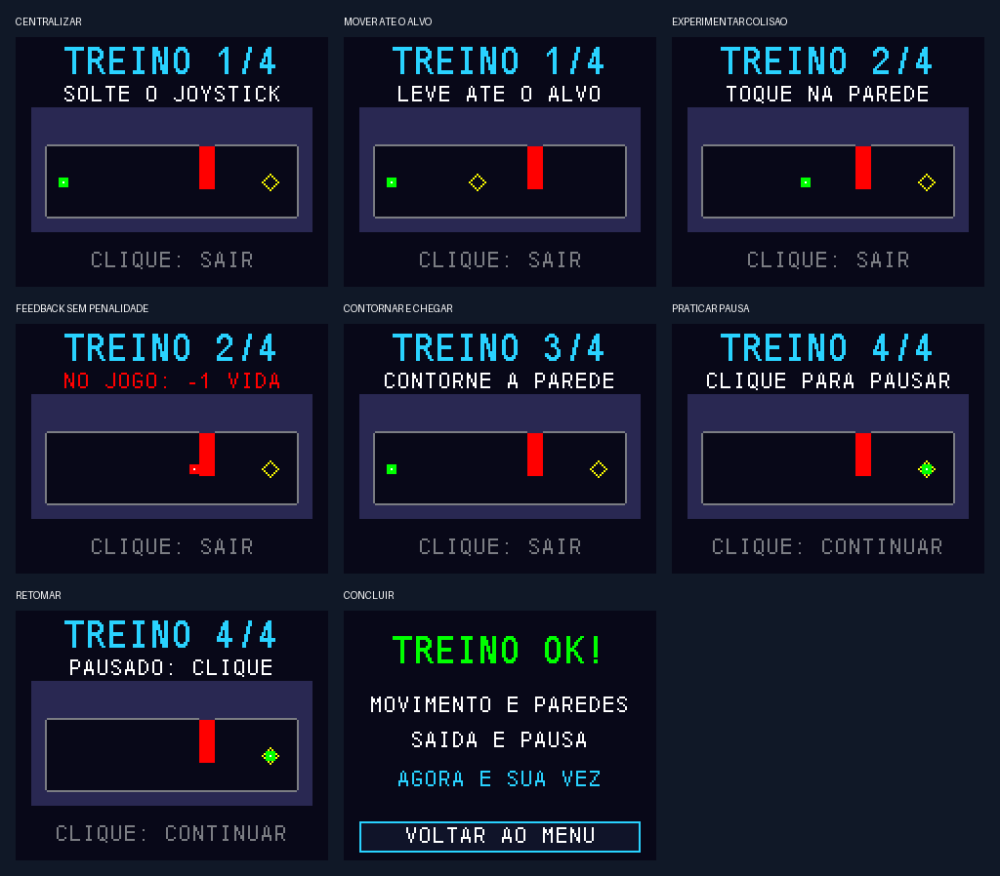

# 3. Implementação (C / FreeRTOS)

> Ferramentas, organização das fontes, decisões técnicas, compilação e gravação.
>
> Página **3 de 4** · [Sumário](README.md)

---

## Ferramentas e ambiente

- **C / HAL / CMSIS / FreeRTOS:** base STM32 fornecida pelo professor.
- **STM32CubeIDE:** importação, compilação e depuração por ST-Link.
- **CubeMX 6.18 e STM32CubeF4 v1.28.3:** ensaio de regeneração em cópia controlada.
- **GNU Arm GCC 14.3.1:** compilação local de referência, com `-O0 -Wall`.
- **Python 3 e GCC/Clang:** geração de mapas e testes de host em Linux/WSL.

O `.ioc` preserva o formato da base 6.17. A migração ensaiada para 6.18 e a
correção conhecida do protótipo de hook são descritas em
[REGENERACAO.md](docs/REGENERACAO.md).

## Estrutura de arquivos implementada

```text
projeto-jogo/
  Game_Start2_STM32F411CE/
    Core/Inc/                 interfaces e configuracao
    Core/Src/
      main.c                  HAL, perifericos e bootstrap
      app_game.c              tarefas, filas e diagnosticos RTOS
      joy_input.c             calibracao, filtro e debounce
      maze_game.c             regras, estados e tutorial
      maze_map.c              consultas e colisao
      maze_mapdata.c          mascaras geradas
      game_renderer.c         telas e atualizacao parcial
      st7735.c / fonts.c      driver e fontes
    Game_Start2_STM32F411CE.ioc
  assets/maps/                nove plantas JSON
  scripts/                    geracao, compilacao e verificacao
  tests/                      logica, entrada, desenho e SPI
  docs/                       relatorio, montagem e evidencias
```

## Decisões de implementação

### Movimento e colisão

A posição usa inteiros com resolução de milésimo de pixel. O deslocamento é
proporcional aos eixos, limitado a 24 pixels/s e normalizado na diagonal.
`Maze_SweepFree` verifica o ponto inteiro 5×5 e as posições intermediárias,
evitando atravessar paredes entre atualizações.

A geometria vem dos nove JSONs, convertidos em máscaras constantes pelo gerador.
O treino usa uma máscara própria com um obstáculo. O movimento e a colisão são
compartilhados com a campanha.

### Controle por estados e snapshots

`Game_Tick` recebe uma entrada e um intervalo de tempo, atualizando `Game`.
As regras não chamam HAL nem desenham diretamente. A tarefa de lógica publica
uma cópia de `Game`, e a tarefa de desenho confirma o identificador de cena.

Exemplo real de transição após alcançar a saída:

```c
if (Maze_Exit(Maze_Get(g->map_index), Game_X(g), Game_Y(g))) {
    g->map_score = Game_Score(Maze_Get(g->map_index),
                             g->active_ms, g->collisions, g->timeouts);
    g->score += g->map_score;
    state(g, GAME_RESULT);
}
```

Fonte: [maze_game.c](Game_Start2_STM32F411CE/Core/Src/maze_game.c).
A confirmação do resultado avança uma única fase; ao concluir M09, abre vitória.

### Tutorial interativo

COMO JOGAR ensina centralização, alvo, colisão, desvio e pausa. A colisão de
treino explica a perda de vida do jogo, mas não altera vidas/pontos reais.
Centralização e confirmação de desenho são exigidas entre etapas.



### Tratamento de falhas

Retornos de criação de tarefas/filas e início de DMA são verificados.
O SPI possui timeout; idade das amostras e atraso da lógica são observados.
Os hooks de stack overflow e falha de alocação ficam em USER CODE de
`freertos.c`, preservados pela regeneração documentada.

---

## Como compilar e gravar

```sh
git clone https://github.com/mateusalgado/IFSC_MIC2.git
cd IFSC_MIC2/projeto-jogo
```

Em um clone existente, atualizar com `git pull --ff-only`, preservando alterações locais.

1. Importar `Game_Start2_STM32F411CE` como projeto existente no STM32CubeIDE.
2. Manter `APP_DIAGNOSTIC=0`; executar Refresh → Clean → Build.
3. Selecionar o ELF recém-compilado no Run/Debug e gravar com ST-Link.
4. Soltar o joystick ao iniciar e conferir **TUTORIAL v0.4** na tela inicial.

Não é necessário regenerar para compilar. Alternativa com Python e GNU Arm Embedded:

```sh
python3 scripts/check_config.py
python3 scripts/build_base.py
python3 scripts/build_base.py --diagnostic
```

No Windows, usar `python` e fornecer `--cc` com o caminho do compilador, se necessário.
O build normal gera `build/campanha/labirinto-campanha.elf/.hex/.bin`;
o diagnóstico gera `build/diagnostico/diagnostico-spi1.*`.

No CubeProgrammer, gravar o HEX com verificação; para BIN, usar **0x08000000**.
Os scripts não gravam automaticamente. Os artefatos do CI são
`mic2-labirinto-campanha` e `mic2-diagnostico-spi1`.
Procedimento completo: [campanha](docs/CAMPANHA.md).

## Executar os testes

```sh
python3 scripts/check_config.py
python3 scripts/generate_map.py --check
python3 scripts/test_host.py --sanitize
```

Os testes de host exigem GCC/Clang em Linux/WSL. Os resultados e as limitações
estão na próxima página.

---

<div align="center">

[Retroceder](projeto.md) | [Sumário](README.md) | **3 / 4** | [Avançar](testes.md)

</div>
