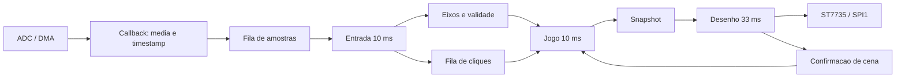
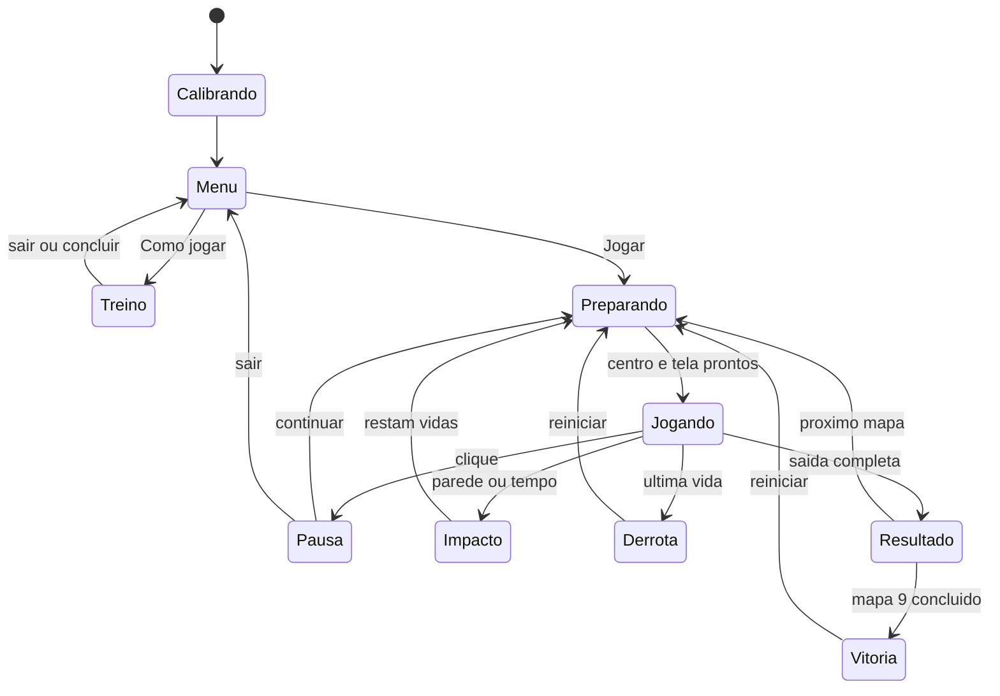
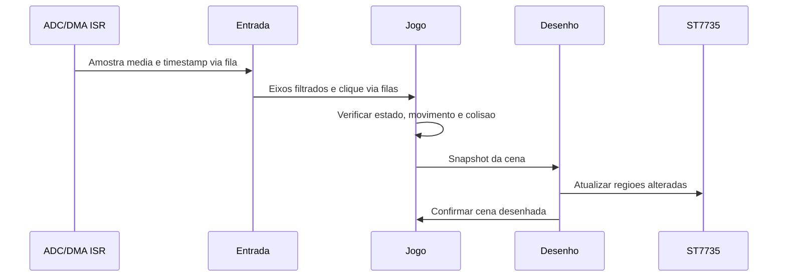

# 2. Projeto do sistema

> Arquitetura, hardware, responsabilidades dos módulos e comunicação FreeRTOS.
>
> Página **2 de 4** · [Sumário](README.md)

---

## Decisões de projeto

A entrada, a lógica e o desenho são separados. Somente a lógica altera o estado
da campanha; somente o desenho acessa o display. As tarefas trocam amostras,
eventos e cópias do estado pelas filas do FreeRTOS.

- **Entrada:** período nominal 10 ms; prioridade 4; pilha 256 palavras.
- **Jogo:** período nominal 10 ms; prioridade 3; pilha 512 palavras.
- **Desenho:** período nominal 33 ms; prioridade 1; pilha 512 palavras.
- **Bootstrap:** cria recursos, inicia ADC/DMA e se encerra.
- **Heap do RTOS:** 15360 bytes; diagnóstico de falhas de alocação e pilha ativo.

Cada palavra de pilha tem 32 bits. Esses valores são configurações, não medições
de uso máximo. A tela tem proprietário único; não exige mutex entre tarefas.

## Hardware

TFT: VCC/LED em 3V3, GND em G, CS PB12, RESET PB13, A0/DC PB14,
SDA/MOSI PA7 e SCK PA5. Joystick: alimentação 3V3, VRY PA0, VRX PA1 e SW PC15.
PA8 permanece reservado ao áudio; não há buzzer implementado nesta revisão.

O MCU usa HSI/PLL a 96 MHz, SPI1 nominal de 12 MHz e ADC1 com DMA circular.
O tick HAL usa TIM4. Pinagem, imagem dos componentes e alimentação:
[HARDWARE.md](docs/HARDWARE.md).

---

## Arquitetura e fluxo de dados

Amostras, eixos e snapshots usam filas de comprimento 1 para manter o dado mais
recente. Cliques usam fila de oito eventos. A confirmação da cena impede iniciar
movimento antes de a tela estar pronta. ISR não desenha nem espera por SPI.

## Responsabilidades dos módulos

- **joy_input:** calibração, filtro, zona morta e debounce.
- **maze_game:** máquina de estados, deslocamento, vidas, pontos e treino.
- **maze_map / maze_mapdata:** máscara de paredes, catálogo e varredura de colisão.
- **game_renderer:** menu, HUD, tutorial, mapas e atualização parcial.
- **app_game:** filas, tarefas e integração com HAL/FreeRTOS.
- **st7735:** comunicação SPI, limites gráficos e timeout do periférico.

As máscaras constantes são usadas tanto para desenhar quanto para detectar
colisão. Não existe uma segunda geometria visual independente.

## Estados e interação

Falhas técnicas de ADC, SPI, fila ou atraso levam ao estado de falha, com
reinicialização solicitada ao usuário. O tutorial tem oito etapas internas,
sem descontar vidas nem conceder pontos.

## Sequência de uma atualização

O desenho mantém buffer de 160×8 pixels, sem framebuffer completo e sem alocação
a cada quadro. Regras e parâmetros detalhados: [relatório](docs/RELATORIO.md).
Configuração reproduzível: [regeneração](docs/REGENERACAO.md).

---

[Retroceder](analise.md) | [Sumário](README.md) | **2 / 4** | [Avançar](implementacao.md)

